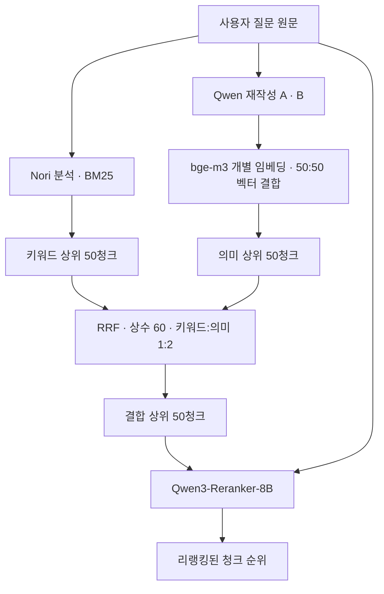

# Teams Document Search

**정확한 파일명이나 문서 속 표현을 몰라도, 자연어 질문으로 필요한 사내 문서와 근거를 찾기 위한 검색 프로젝트입니다.**

여러 형식의 문서를 공통 구조로 파싱·보강·청킹한 뒤 Elasticsearch에 색인합니다. 검색에서는 키워드와 의미 기반 후보를 결합하고, 리랭커로 관련 청크의 순서를 개선합니다. Teams는 목표 사용 환경이며, 실제 Teams·SharePoint 연동은 아직 구현하지 않았습니다.

> **2026-11-12 게시 기준:** 2026-11-11에 완료한 A·B 재작성 → 하이브리드 검색 → API 리랭커 평가를 기준으로 설명합니다. 실행 중인 서비스나 운영 배포 완료를 뜻하지 않습니다. 저장 결과 재채점은 API 없이 실행할 수 있습니다.

## 현재 어디까지 구현했나요?

| 영역 | 상태 |
|---|---|
| 문서 준비 | 형식별 파싱·공통 블록, 규칙 보강과 선택적 비전/LLM 보강, 토큰 청킹 구현 |
| 색인 | Elasticsearch Nori/BM25 텍스트 색인과 bge-m3 벡터 색인 구현 |
| 검색 | 원문 키워드 검색, 재작성 A·B 의미 검색, RRF 결합 구현 |
| 재정렬 | SiliconFlow Qwen3-Reranker-8B 연결 및 전체 개발 질문 평가 완료 |
| 결과 표현 | 문서·버전 묶기와 원문 위치 연결의 기존 구현 있음. 아래 청크 지표와 구분 |
| 업무 서비스 | SharePoint 수집·변경분 동기화·사용자 권한·Teams 연결·운영 검증은 남음 |

## 현재 검색 흐름



- **질문 원문**은 키워드 검색과 리랭커에 전달합니다.
- **재작성 A·B**는 각각 정규화한 임베딩을 같은 비율로 합쳐 다시 정규화합니다. 두 검색 순위를 합치는 것이 아니라, 하나의 의미 검색 벡터를 만듭니다.
- 사용자 사전·검색어 확장 사전은 사용하지 않습니다. Nori 자체의 기본 분석 사전과는 구분합니다.
- 이번 기준에는 2차 Qwen 요구사항 판정, Jev, Min-max 재정렬이 포함되지 않습니다.

## 기술과 역할

| 역할 | 기술 / 모델 | 현재 평가의 실행 위치 |
|---|---|---|
| 한국어 분석·키워드 검색 | Elasticsearch · Nori · BM25 | Elasticsearch |
| 질문 재작성 | Qwen3.6-35B-A3B | OpenRouter API |
| 질문 임베딩 | bge-m3 | OpenRouter API, DeepInfra 지정 |
| 의미 검색 | Elasticsearch dense_vector · cosine | 기존 벡터 색인 |
| 순위 결합 | 가중 RRF | 애플리케이션 코드 |
| 리랭킹 | Qwen3-Reranker-8B | SiliconFlow API |

모델 추론은 위 API에서 수행하며, 요청 구성·벡터 결합·검색·결과 집계는 애플리케이션과 Elasticsearch에서 수행합니다. 과거 Orin 로컬 모델 시험은 별도 이력입니다.

## 평가 환경과 최근 결과

| 항목 | 기준 |
|---|---|
| 대상 문서 | 195개 예비 문서 |
| 청크·문서 벡터 | 총 3,022개: 원문 2,991개 + 의미 보강 31개 |
| 임베딩 차원 | bge-m3 1,024차원 |
| 청킹 | 전체 임베딩 입력 400~600토큰 목표, 최대 600토큰, 구조 보존 |
| 질문 | 개발 질문 82개: 일반 74개 + 추가 확인 대상 8개를 진단용으로 포함 |

**성공 = 등록된 필수 정답 근거 묶음이 모두 상위 N청크 안에 포함됨.** 정답 문서의 아무 청크를 찾은 경우나 생성 답변 정확도가 아닙니다.

| 단계 | 상위 10 성공 | 상위 20 성공 | 상위 50 성공 |
|---|---:|---:|---:|
| 키워드 검색 | 44/82 (53.66%) | 55/82 (67.07%) | 64/82 (78.05%) |
| 의미 검색 | 65/82 (79.27%) | 70/82 (85.37%) | 79/82 (96.34%) |
| RRF | 64/82 (78.05%) | 69/82 (84.15%) | 79/82 (96.34%) |
| 리랭커 | 79/82 (96.34%) | 79/82 (96.34%) | 79/82 (96.34%) |

리랭커는 주어진 후보의 순서만 바꾸므로 후보 밖 근거를 새로 찾지 못합니다. 반복 사용한 개발 질문집의 결과이며, 미사용 실제 질문의 일반화 성적이나 운영 통과를 의미하지 않습니다. API 재시도와 중단 후 재개가 있어 시간은 [상세 평가 문서](docs/EVALUATION.md)에서 구분합니다.

## 먼저 실행해 보기 — 추가 API 비용 없음

Python 3.10 이상에서 저장된 순위와 정답을 다시 대조합니다. Elasticsearch·모델·API 키 없이 실행됩니다.

```bash
python3 evaluation/replay.py
```

이 명령은 새 검색을 실행하지 않습니다. 새 API 검색의 자원·설정·재현 제한은 [실행 안내](docs/SETUP.md)를 확인하세요. 과거 `localhost` 화면 링크는 공개 데모가 아닙니다.

## 문서와 코드 안내

| 읽을 내용 | 위치 |
|---|---|
| 현재 구조·설정·코드 진입점 | [구조 설명](docs/ARCHITECTURE.md) |
| 원문 → 단일 재작성 → 벡터 혼합 → A·B → 리랭커의 변경 이유 | [검색 발전 과정](docs/SEARCH_EVOLUTION.md) |
| 지표·실패·시간·재채점 | [평가 설명](docs/EVALUATION.md) |
| 실행 방법·필요 자원·게시 범위 | [실행 안내](docs/SETUP.md) |
| 최신 실험 원본 보고서 | [전체 검색 평가](outputs/search-reranker-only-full-001/REPORT.md) |
| 게시 파일·원본 대조 해시 | [게시 목록](evaluation/publication-manifest.json) |

`deploy/`는 구현, `outputs/`는 당시 실험의 고정 코드·보고서입니다. 코드 참조를 보존하기 위해 기존 경로를 유지하고 위 문서로 현재 기준을 안내합니다. 옛 보고서의 “현재”와 “완료”는 당시 시점을 뜻합니다. 이번 공개 범위는 검색·리랭킹까지이며, 새로운 조건 판정 설계는 포함하지 않습니다.
