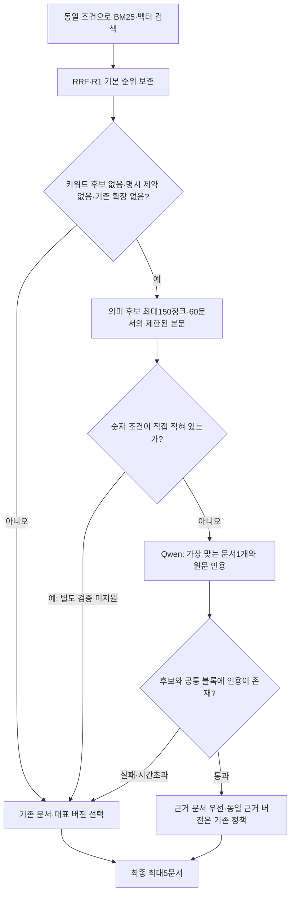
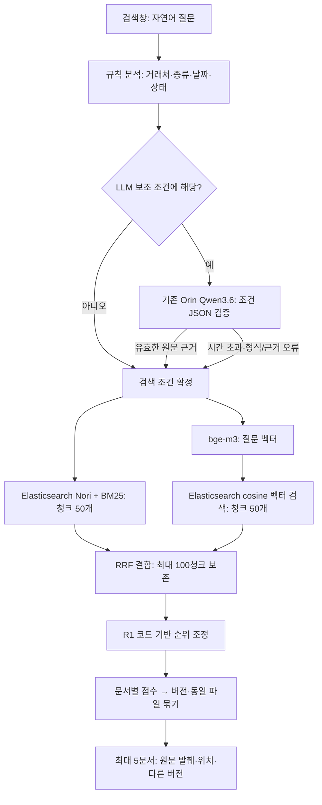

# 검색 설계와 첫 구현

2026-10-20. 사용자 요청으로 검색 구현을 시작했다. 기준은 첨부한 `RAG_전체구조와_실제입출력_통합설명.md`와 그 문서가 참조하는 `RAG_검색설계_for_GPT(20261020).md` v2.17이다. 원본 첨부 문서는 수정하지 않았다.

**현재 검증 화면은195문서·3,754청크의 v003를 B+R1으로 검색한다(18022). Qwen 원문 대조 실험은 현재 비활성이다.** 동일166질문 재평가에서 기존150개148/150, 변형16개10/16. [OFF 전환·비교 기록](../outputs/search-v31-source-review-off-001/REPORT.md). v002(18021)와 v001(18020)은 보존한다.** 실제 SharePoint 수집·변경분 동기화, 직원별 권한 확인, Teams 배포는 이 구현에 포함되지 않는다. 현재 선택적 요약·의미 보강은31개이며 기존17개 결과를 포함한다. 질문에 대한 생성형 답변이나 결과별 새 요약은 만들지 않는다. 아래 첫 구축 기록과 이후 버전 변경을 구분한다.

## 2026-10-26 조건부 Qwen 원문 대조 실험 기록 — 현재 비활성

현재 화면은 search-1.7.4의 RRF·R1·문서 묶기를 사용한다. 아래 흐름은 search-1.8.4에서 시험한 원문 대조 방식의 보존 기록이며, 현재는 실행되지 않는다. 새 단어 규칙과 문서 재색인은 없다.

원문 대조는 모델 기반 리랭킹 역할이지만, 후보 전부에 점수를 붙이는 전용 cross-encoder와는 다르다. `bge-reranker-v2-m3` 실험은 미채택했고 해당 컨테이너는 중지했다. 기본 임베딩은 bge-m3 그대로다. 질문 분석2.5초 제한은 유지하며 원문 대조는 최대90초/출력160토큰이다. 실제 입력은 총 약24,000자 분량으로 제한하며 긴 문서 전체를 읽었다고 설명하지 않는다.

원문 인용 검증은 모델 의미 판단이 완벽하다는 보증이 아니다. 숫자 비교·금액 같은 조건의 별도 검증이 없는 질문은 순위를 뒤집지 않는다. 같은 문서군에 근거가 공백·줄바꿈 차이만 두고 존재할 때에만 기존 최종본·최신본 선택을 유지한다. 다른 근거를 가진 최신본으로 자동 대체하지 않는다. 오류 시 확대 후보의 순위 대신 원래50청크 기반 결과를 반환한다.

최종166개 평가: 기존148/150 유지, 변형16/16(이전10/16), 실패6개 모두1위. 평균1.37→3.74초로 지연이 늘어 기존3초 목표를 통과한 것으로 보지 않는다. 이는 정확도를 우선한 개발 화면 변경이며 독립 검증·동시 요청 성능 보증은 아니다. [세부 평가](../outputs/search-v31-semantic-001/REPORT.md).

## 아래는 최초 구축 및 이후 누적 설계 기록

## 사용하는 기술과 역할

| 부분 | 기술 | 실제 역할 |
|---|---|---|
| 질의 분석 | Python 규칙 + 기존 Qwen3.6-35B-A3B-AWQ-4bit/vLLM | 명시된 거래처·문서종류·기간 등 추출. 모델이 제안한 조건은 허용 값과 질문 속 근거를 검증한다. |
| 키워드 검색 | Elasticsearch 8.19.23, Nori mixed, BM25 | 기존 거래처·시스템 사전을 Nori 사용자 사전에 추가하고, 파일명·머리말·본문을 검색한다. |
| 의미 검색 | 기존 bge-m3, Transformers/PyTorch | 원문 질문에 접두어를 붙이지 않고 1,024차원 벡터를 만든다. 색인 때와 같은 모델 해시·CLS·L2 정규화·FP16 계산을 사용한다. |
| 벡터 저장/검색 | Elasticsearch dense_vector, cosine, flat | 현재 v003의3,754벡터를 재사용한다. FAISS를 실행하지 않는다. 현재 flat이므로 HNSW 근사 검색으로 설명하지 않는다. |
| 결합·정렬 | Python RRF, 선택적 R1 | BM25 점수와 cosine을 직접 더하지 않고 순위로 합친다. R1은 별도 모델 없는 코드 기반 실험이다. |
| API·확인 화면 | FastAPI, Uvicorn, HTML/JavaScript | 검색창 하나와 문서 카드를 제공한다. 검색·클릭 기록을 저장하지 않는다. |
| 실행 환경 | Orin의 별도 Docker 컨테이너 `rag-search-v31-validation` | bge-m3를 한 번 로딩해 계속 재사용한다. 기존 Qwen·Elasticsearch 컨테이너는 유지한다. |

## 구현 순서와 시작값

1. 원본을 바꾸지 않고 검색용 메타데이터를 준비했다. 파일명·폴더·추출된 버전과 수정 시각으로 문서군을 만들고, 파일 해시로 동일 사본을 연결한다. 이전 색인을 보존한 별도 `rag-search-documents-v001`, `rag-search-chunks-v001`에 저장한다.
2. 질문 분석과 두 검색 분기를 연결했다. 같은 강제 조건을 BM25와 벡터 검색에 적용한다.
3. RRF, 문서별 묶기, 원문 발췌, 0건 완화, 검색 API와 화면을 연결했다.
4. 정해진 61개 질문으로 A/B 필터와 R0/R1을 비교한다. 전체 통과 여부는 [평가 보고서](../outputs/search-service-001/REPORT.md)에 따로 기록한다.

| 설정 | 현재 구현 |
|---|---|
| BM25 | 파일명 2배, 문맥 머리말·표 머리글 1.5배, 본문 1배; 최소 단어 일치 50% |
| 기존 한영 사전 | 이전에 검수한 operations vocabulary를 그대로 사용. 새로운 질문별·문서 ID별 가중치 없음 |
| 후보 | BM25 50청크 유지. 벡터 기본50청크/num_candidates200. 한 문서가26개 이상이면 문서당3청크로 다양화하고 보충 조회(회당150, num_candidates600, 첫 조회 포함 최대6회). 날짜 등 업무 필터 유지 |
| RRF | 동일 비중, `1/(60+순위)`, 중복 제거 후 최대 100청크 모두 전달 |
| 문서 점수 | search-1.6.0부터 검색된 최고 청크 점수. 같은 문서의 추가 청크 개수로 가산하지 않음 |
| R1 | 정규화 RRF 45%, 제목/본문 단어 일치 20%, cosine 20%, 구문 일치 5%, 번호 일치 5%, 조건 선호 5% |
| A 조건 | 거래처·문서종류·명시적 날짜·명시적 상태는 강제, 최신본은 선호. 대상 시스템·통화·VAT·실행결과는 추가 선호 |
| B 조건 | 거래처·명시한 날짜 범위는 필수. 기간과 함께 명시한 문서종류, 포함 내용과 그 바깥 문서종류도 필수. 기간이 있는 작업 로그 질문은 추출 작업명을 필수 확인. 나머지는 선호 |
| 후보의 선호 반영 | BM25 조회에서 명시된 선호 조건마다 constant score 1점, 최신본 1점 가산. 벡터 분기는 동일 강제 필터를 적용한 원래 cosine 순위 유지 |
| R0의 선호 반영 | 조건 선호율에 따라 RRF 점수를 최대 10% 가산 |
| LLM | temperature 0, thinking off, JSON schema, 출력 최대 300토큰 |
| LLM 대기 예산 | 첫 실행 3초. 전체 3초 목표를 위해 두 번째 실행부터 2.5초로 제한하고 나머지를 검색·카드 생성에 남김. 형식 오류는 남은 예산 안에서 최대 1회 재시도 |
| 상대 날짜 | 화면은 서울 시간 오늘, 고정 평가는 2026-10-14 |

A/B는 Hit@5가 2문항 이상 차이 나면 높은 쪽, 그보다 작으면 정답을 제외한 강제 필터가 적은 쪽, 다시 같으면 B를 고른다. R1은 Hit@5가 2문항 이상 또는 MRR이 0.05 이상 개선되고, 유형별 하락이 3%p 이내이며, 응답 시간 기준을 유지할 때만 채택한다. 설계 문서가 `Recall@5`라고 부른 **정답 문서가 하나라도 보인 질문의 비율**은 혼동을 피하려고 보고서에서 `Hit@5`로 표시한다. 모든 정답 문서의 개별 재현율은 별도로 계산한다.

R1은 두 분기 중 어디에서 나온 청크인지와 관계없이, 합친 최대 100개 청크의 저장 벡터와 현재 질문 벡터로 실제 cosine을 다시 계산한다. 벡터 상위 50개에 없다는 이유로 cosine을 0으로 취급하지 않는다. 초기 실행에서 빠져 있던 두 연결(후보 단계의 선호 가산점, BM25 전용 후보의 cosine)을 보완한 기록도 결과 디렉터리에 보존한다.

## 입출력 규칙

`POST /search`의 기본 입력은 `{"query":"청람정밀 MES 고도화 계약서"}`다. 확인용 API에는 고정 평가 날짜, A/B, R0/R1을 지정하는 선택 입력도 있다. 화면에는 이런 선택 필터를 두지 않는다.

출력은 `status`, `query_plan`, `results`, `relaxed_conditions`, `timings`, `diagnostics`다. 날짜 정렬에는 `date_coverage`와 `undated_results`, 포함 내용 검색에는 카드의 `content_evidence`도 제공한다. 각 문서에는 식별자, 실제 파일명, 추출 메타데이터, 원문 발췌, block_id와 문자 범위, 페이지/슬라이드/셀/줄 위치, 다른 버전, 최신본 연결이 들어간다. 실제 원본 URL이 없으면 `url:null`로 반환한다. 예비 데이터에는 SharePoint 링크가 없어 원본 열기 버튼을 만들지 않는다.

발췌는 저장된 공통 블록에서 실제 문자열을 잘라 낸다. 파생 머리말이나 LLM이 작성한 시각 구조 설명을 원문 인용으로 바꾸어 보여주지 않는다. 키워드 일치가 있으면 최대 3개·각 최대 100자, 의미 검색만 일치하면 직접 발췌 1개를 표시한다. 표시할 직접 인용이 없으면 그 상태를 명시한다.

대표 문서는 질문이 지정한 버전 → 지정한 상태 → 번호 근거를 가진 버전 → 요청한 최초 숫자 버전 → 요청한 날짜 순서 → 검색 후보 중 최신본 순으로 선택한다. search-1.6.0에서는 같은 번호가 맞는 후보끼리 서명본·최종본을 초안보다 우선한다. 다른 번호의 최신 문서로 바꾸지 않는다. 최신본이 검색 후보에 없으면 일치한 이전 버전을 대표로 두고 최신본 정보를 연결한다. 다른 버전의 근거를 최신본에 붙이지 않는다. 같은 해시의 사본은 깨끗한 파일명을 우선한다. 파일명 끝의 `(1)` 같은 사본 이름은 대응 원래 이름의 후보와 버전·상태·수정시각이 모두 같을 때 원래 이름을 대표로 선택한다. 이것은 바이트/내용 동일성을 새로 판정한다는 뜻이 아니다. 명시한 버전·상태·날짜순·사본 요청은 보존한다. 나머지 동률의 문서 ID 선택을 실제 최초 업로드 순서라고 부르지 않는다.

두 검색 분기가 모두 0건일 때만 완화 가능한 문서종류 → 상태 순으로 조건을 완화하고 화면에 표시한다. 명시 날짜는 A/B 모두 절대 풀지 않는다. 기간과 함께 명시한 문서종류도 풀지 않으며, 거래처·명시적 포함 내용·포함 요청의 바깥 문서종류도 유지한다. 검색 서버 오류는 0건으로 취급하지 않고 서비스 오류로 반환한다. 부정 조건, 여러 거래처, 해석하지 못한 기간은 구체화가 필요하다고 반환한다. 단, 연도와 계절을 함께 말하면 확실한 연도를 필수 조건으로 사용하고 계절의 정확한 월은 확정하지 않았음을 표시한다.

### 작성일 정렬과 구성도 포함 조건 — search-1.1.0

‘가장 최근에 작성된’ 또는 ‘작성일 최신순’은 `written_date` 내림차순이다. 수정일은 `file_modified_at`, 표지 날짜는 `cover_date`를 사용한다. 다른 날짜로 대체하지 않는다. 날짜 정렬은 두 분기의 상위 후보 수에 제한받지 않고, 동일 조건에 맞는 전체 청크를 Elasticsearch `search_after`로 2,000개씩 조회한 뒤 문서·버전을 묶고 상위 5개를 선택한다. 현재 색인은 고정 상태를 전제로 한다. 운영 중 변경되는 색인에는 PIT 등 일관된 조회 시점 보장이 별도로 필요하다.

정렬 날짜가 없거나 추출 확정 상태가 아닌 문서는 최신순 순위에서 제외하고 `undated_results`에 별도로 최대 5문서군을 표시한다. `date_coverage`의 문서 수는 버전 묶기 전 파일 수다. ‘최신’은 **작성일이 확인된 일치 문서 중 최신**이며 날짜 없는 자료보다 실제로 나중에 작성되었다고 단정하지 않는다.

‘네트워크 구성도가 포함된 문서’는 바깥 문서종류를 네트워크 구성도로 제한하지 않는다. 기존 공통 블록에서 사실 색인용으로 채택된 구성도 연결선과 연결 노드의 네트워크 장비·망 표현을 확인해 포함 조건을 만든다. 제목·본문에 단어만 등장하거나 보류된 원시 비전 응답만 있는 경우는 근거로 삼지 않는다. 사용자/외부망→보안·네트워크→서버 구성도도 해당하므로 제안서를 포함한다. 단순 서버·로드밸런서 구성만으로는 자동 확정하지 않는 보수적인 규칙이다.

이 조건의 문서 ID 집합은 BM25·벡터·전체 날짜 조회에 동일하게 적용하며 자동 완화하지 않는다. ‘구성도가 포함된 제안서’처럼 바깥 종류도 명시하면 그 종류 역시 필수로 적용한다. 기존 평가 정답이나 특정 문서 ID를 규칙에 넣지 않는다. 시작 시 기존 블록으로 집합을 계산하므로 원본 JSON·임베딩·Elasticsearch 색인을 다시 생성할 필요가 없다. 색인 자료가 바뀌면 블록과 검색 데이터를 함께 갱신해야 한다.

현재 23파일(독립 구성도 10, 제안서 13)의 근거가 확인됐다. 제안서 13개는 표지 날짜만 있고 명시적 작성일이 없어 별도 목록으로 분리된다. 카드에 포함 근거의 페이지/슬라이드와 장비명을 표시한다. 이는 기존 채택 블록에 대한 확인이며 새로운 독립 이미지 검수 점수가 아니다. [수정·회귀 평가](../outputs/search-written-content-001/REPORT.md).

## 단계별 청크 순위 표시 — search-1.2.0

화면은 `POST /search/stream`을 사용한다. 한 번의 검색 실행에서 실제 단계 완료마다 NDJSON 이벤트를 전달한다. 키워드·의미 검색은 병렬로 실행하고 각 응답이 돌아오는 시점에 해당 순위를 표시한다. 인위적인 타이핑 지연이나 추측한 중간 순위를 만들지 않는다. 기존 `/search` 응답과 순위 기준은 유지한다.

- 키워드 검색: 실제 상위 최대 50청크. 의미 검색: 실제 상위 최대 50청크.
- 결합 순위: 중복 청크를 합친 전체 후보 순위. 각 청크의 두 분기 원래 순위도 표시한다. 분기 후보에 없으면 ‘후보 밖’으로 표시한다. 결합 계산식과 점수는 화면에 표시하지 않는다.
- R1 적용 순위: 결합 후보 전체(최대 100청크)를 조정한 결과와 결합 당시 순위를 표시한다. 별도 모델 리랭커를 새로 사용하지 않는다.
- 날짜순 요청: 결합 결과는 참고용임을 밝히고 전체 일치 자료에서 요청한 날짜로 정렬한 청크를 별도 표시한다. R1 결과가 최종 날짜 순위인 것처럼 표시하지 않는다.
- 최종 문서: 기존 문서·버전 묶기 결과이며 청크 순위와 구분한다.

각 행에는 순위, 출처 문서명, 문서 ID·청크 ID, 페이지/슬라이드/문단/셀 위치를 표시한다. 내용 일부(검색용 청크 본문 180자)는 펼쳐 볼 수 있으며 최종 카드의 직접 원문 인용과 구분한다. 각 목록은 처음 5개를 표시하고 나머지 전체 순위는 펼칠 수 있다. 문서를 실시간으로 여는 기능은 추가하지 않았다.

연결이 끊기거나 검색 오류가 발생하면 중간 결과라고 표시하고 완료로 처리하지 않는다. 조건이 모호하여 검색하지 않은 경우 순위를 꾸며 보여주지 않는다. 요청별 임시 큐만 사용하고 운영 검색·단계 로그는 저장하지 않는다. 고정 개발 평가의 단계 응답만 별도 평가 결과로 보존했다. [검증 보고서](../outputs/search-rank-trace-001/REPORT.md).

## 운영 경계와 남은 검증

- 현재 v2 검증 화면: `http://127.0.0.1:18021/`(155문서, Orin8021). 기존110문서 화면18020(Orin8020)은 별도 보존한다. 두 API는 loopback에 바인딩하고 VPN·인증된 SSH 터널로 접근한다.
- 모델은 새로 다운로드하지 않았다. 외부 유료 API는 호출하지 않았다. Qwen의 기존 문맥·메모리 설정도 바꾸지 않았다.
- 기존 색인·17개 요약·벡터·정답·저장 응답은 덮어쓰지 않았다. 검색용 새 색인은 별도다.
- 검색 API는 질문을 저장하지 않고 HTTP 접근 로그도 끈다. 정해진 개발 평가 질문의 응답만 평가 디렉터리에 저장한다.
- 현재는 개발용 화면이다. 실제 문서 권한, 로그인, SharePoint URL·증분 수집, Teams 연결을 검증한 상태가 아니다.
- 정확 번호 검색 결과를 상단에 고정하는 별도 **2a 분기는 보류**한다. R1의 후보 내 번호 점수와 2a 분기를 혼동하지 않는다.
- 새 리랭커 모델 R2/R3, 운영 질문 수집, OpenRouter 유료 재평가, Spark 전환은 실행하지 않았다.
- 독립 평가가 아니다. 원본 정답의 필터와 현재 메타데이터 의미가 어긋나는 항목, 질문별 대표 버전 정답의 별도 검수는 평가 보고서에 남긴다. 자동 점수만으로 전체 검색을 통과했다고 선언하지 않는다.

관련 구현: [질의 분석](../deploy/search/query.py), [검색·결합·근거](../deploy/search/engine.py), [API](../deploy/search/service.py), [평가 실행기](../deploy/search/evaluate_remote.py), [계약 테스트](../deploy/search/test_search.py).

## 간접 표현·날짜·최초 버전 보완 — search-1.3.1 당시 기록

이 절의 날짜 선호 정책은 아래 search-1.5.0의 필수 기간 정책으로 대체됐다.

원본 검색 설계 S-06은 운영 기준일=KST 오늘, 평가 기준일=2026-10-14를 결정했다. S-07의 A/B 비교 후 B(거래처만 강제)가 채택됐다. S-05a의 “여름쯤 등 미해석 날짜에 LLM 호출”은 미정·튜닝 항목이며 계절의 월 범위는 결정하지 않았다. 종전 구현은 미해석 날짜에 검색 자체를 중단했고, LLM 스키마에 날짜 필드도 없어 성공하더라도 이를 풀 수 없었다.

현재 정책은 다음과 같다.

| 표현 | 처리 | 적용 필드 |
|---|---|---|
| 올해 / 작년·지난해 / 재작년 | 기준 연도 / 전년 / 전전년의 달력 범위 | 별도 역할 없으면 document_date |
| 2025년 6월 / 2025년 6월 21일 | 해당 월 또는 일의 정확한 범위, 불가능한 날짜는 확인 요청 | 질문의 날짜 역할 |
| 작년 여름쯤 | 2025년만 우선, 여름의 월 범위는 확정하지 않음 | document_date(별도 역할 없을 때) |
| 재작년 겨울 무렵 | 2024년만 우선, 겨울을 전후 연도나 특정 월로 단정하지 않음 | document_date(별도 역할 없을 때) |
| 여름쯤 / 지난 분기 등 현재 미지원 표현 | 기준 연도·범위 확인 요청 | 임의 필터 없음 |
| 작성일 / 작성된 | 명시 작성일 | written_date |
| 표지 날짜 | 표지에 적힌 날짜 | cover_date |
| 수정일 | 수집한 파일 최종 수정 시각(KST 경계 사용) | file_modified_at |
| 로그의 날짜 | 실행 시작일 | log_start |

B에서는 날짜에 맞지 않는 문서도 나올 수 있다. 날짜 선호와 “작성일 최신순” 같은 명시적 정렬은 다르다. 정렬은 전체 일치 자료를 해당 필드로 정렬하며 미확인 날짜를 다른 날짜로 대신하지 않는다. 제출일은 원문 근거 없이 만들지 않는다. 계약기간과 문서일자의 구분은 별도 남은 작업이다.

“바코드 단말기”→PDA/바코드, “와이파이”→무선/WiFi, “운송 시스템”→TMS/운송관리, “서버 옮긴·이전·이관”→migration/cutover/이전/이관은 검색어 확장으로만 사용한다. 인식한 각 개념은 모두 만족해야 하며 개념 내부 대체어는 하나 이상 일치하면 된다. 이를 거래처 추정이나 새 강제 필터로 사용하지 않는다. 기존 단어 검색과 원문 질문의 벡터 검색도 유지한다.

결합 뒤 상위 30개를 먼저 버리던 제한을 없애고, 이미 받은 BM25 50개와 벡터 50개의 합집합(최대 100청크)을 R1에 전달한다. 추가 문서 임베딩·모델 리랭킹은 없다. 화면과 진단 JSON에 실제 전달 수를 반영한다. `rrf_top30`은 종전 비교용이며 현재 전달 범위는 `rerank_candidates`다.

“첫 견적”, “처음 뽑은 가격표” 등은 검색된 같은 문서군의 숫자 버전 중 가장 작은 값을 대표로 고른다. v1을 무조건 강제하지 않으며 v2와 v10은 숫자로 비교한다. 찾지 못한 이전 버전까지 최초라고 보장하지 않는다.

후보 확장 검증에서 낮은 순위의 추가 청크까지 가산하자 긴 계약서가 단일 구성도를 밀어내는 회귀가 확인됐다. 후보 경쟁 범위(최대 100개)와 보조 가산점 범위(기존 결합 상위 30개)를 분리했다. 31위 이후도 문서의 최고 근거로 채택될 수 있지만 약한 추가 청크를 여러 개 가진 것만으로 점수를 더 받지는 않는다. 문서 종류나 정답 ID별 예외는 없다. 계절 단어는 단어 경계를 확인해 ‘새봄병원’의 ‘봄’을 날짜로 읽지 않는다.

## 검증된 조건을 통한 후보 확보와 우선순위 — search-1.4.0 당시 기록

이 절의 B에서 후보를 제거하지 않는 원칙 중 명시 기간·기간 내 작업 로그 부분은 아래 search-1.5.0으로 대체됐다. 날짜 없는 질문의 선호 처리는 유지한다.

질문이 본문과 충분히 겹치지 않아도 이미 검증한 메타데이터 조건으로 후보를 발견하도록 보완했다. 다음 경우에 적용한다.

- 명시 문서종류와 VAT/통화/실행결과 중 하나 이상이 함께 있는 경우.
- 명시 실행 로그 종류, 확실한 실행기간, 작업 개념(백업·복원·복구·배포·전환·장애조치·훈련·시험·복제)이 함께 있는 경우.

모든 인식된 조건이 `extracted` 상태이며 값도 일치하는 문서를 후보로 추가한다. 로그 작업 개념은 추출된 `job_name`에서 기존 한영 사전으로 대조하며, 본문에 한 번 언급됐다는 이유로 해당 작업 로그로 판정하지 않는다. 로그의 실행기간은 `log_start`를 사용하고, 날짜 범위의 마지막 날23:59도 포함한다. 수정일로 대체하지 않는다. 연도+계절처럼 일부만 해석한 날짜에는 이 실행기간 우선규칙을 적용하지 않는다.

BM25의 본문 조건과 메타데이터 조건은 OR로 연결한다. 기존 두 분기의 강제 조건은 동일하며 B의 기본 원칙(거래처만 강제)은 유지한다. 이 후보도 BM25 상위50개 제한 안에 있고, 벡터검색에는 새 강제 필터를 넣지 않는다. 확정 조건이 함께 맞는 청크·문서를 먼저 배치하고 그 안에서는 기존 RRF/R1 점수를 사용한다. 다른 후보를 삭제하지 않으며, 조건 충족 후보가 없으면 기존 검색 순서로 돌아간다. 따라서 무조건 일치만 반환하는 필터가 아니다.

API의 `query_plan.verified_preference`는 적용 이유·검증 필드·작업 개념을, `preferred_doc_ids`는 현재 색인의 검증된 메타데이터로 계산한 문서 집합을 기록한다. 이 집합은 평가 정답이나 고정 문서 ID 목록에서 읽지 않는다. 실제 결과 카드의 `verified_condition_match`는 표시되는 대표 버전 자체에 대한 판정이다. 최신본에 조건이 없고 이전 버전에만 있으면 근거가 있는 버전을 고르되, 질문이 특정 버전·상태·번호를 명시한 우선순위는 보존한다.

Q-053에서 ‘공공기관’을 특정 거래처에 대응시키는 규칙을 추가하지 않았다. 이번 후보 확보의 근거는 검수된 견적서·VAT 포함 값이며, 나머지 표현은 기존 본문·의미 검색에 남긴다.

## 현재 필수 기간 정책 — search-1.5.0

사용자 요청: 날짜가 명확하면 해당 기간만 표시하고, 0건이어도 기간을 풀지 않는다.

- `query_plan.required_dates`와 `locked_filters`에 기간을 보존한다. A/B 모두 동일하게 BM25·벡터의 Elasticsearch 필터에 넣고, 문서 묶기에서도 다시 확인한다. 명시 기간 질문의 날짜 미확인 문서와 기간 밖 다른 버전은 화면에서 제외한다.
- 기간과 명시 문서종류를 함께 잠근다. 예: 2024년 계약서가 없다고 2024년 제안서나 2025년 계약서로 대체하지 않는다. 0건은 `no_results`로 표시하고 날짜를 유지한다.
- 일반 문서일자, 명시 작성일, 표지일, 파일 수정일, 로그 실행 시작일을 구분한다. 유지보수 적용연도/계약기간 질문은 `contract_start`~`contract_end`가 요청 기간과 겹치는지를 원문 추출 상태와 함께 확인한다. 작성·체결을 명시하면 이 적용기간 규칙으로 대체하지 않는다. 예: Q-008은 문서일자2024-12-22라도 계약 적용기간2025년에 해당한다.
- 기간이 있는 실행 로그 질문의 백업·복원 등 작업 개념은 추출 `job_name`으로 검증한 문서 집합을 두 검색에 동일하게 적용한다. DB SNAPSHOT도 백업의 한 형태로 인정한다. 본문의 우연한 언급은 인정하지 않는다.
- 상대 연도는 운영 KST 오늘 / 평가2026-10-14 기준이다. 계절의 월 범위는 아직 미정이며 확실한 연도만 필수로 제한한다. 날짜 해석과 필터 준수는 별개의 검증 범위다.
- UI는 해석한 기간과 ‘결과가 없어도 기간을 넓히지 않습니다’를 표시한다. 청크 순위와 출처 표시는 유지한다.

평가 원본은 수정하지 않았다. 원본 정답 기준97/99이며 Q-068·Q-069는 과거 날짜 완화 기대와 충돌한다. 나머지97개는 기존 성공 유지. 별도 정책 점검에서 두 질문의 빈 결과, Q-061의 정확히3문서, 날짜11질문의 모든 후보·최종 카드·다른 버전 기간 준수를 확인했다. [비교 보고서](../outputs/search-strict-date-fix/REPORT.md).

## 대표 버전·문서 점수·설정/로그 표현 연결 — search-1.6.0

같은 번호의 후보끼리 서명본·최종본 우선, 파일명 사본 동률 해소, 추가 청크 가산점 제거를 적용했다. 일반 질문과 장비 설정·SSH 명령·회선 라벨·랙 목록의 원문 표현을 연결하고, 각 개념군과 검증된 조건을 모두 만족하는 문서를 후보와 우선순위에 반영한다. 기존 BM25/벡터/RRF/R1·명시 날짜 필수 정책은 유지한다. 특정 질문/정답 ID를 규칙으로 넣지 않았다.

155문서 색인을 재사용한 최종125질문: 기존97/99 회복·신규26/26, 전체123/125. Q-068/069는 기간 완화 정답 충돌로 유지. 동작45검사 통과. 제한2.5초와12초 비교에서상위5순위125개전부동일,모델분석채택0/33→1/33,평균1.00→3.45초. 기본2.5초 유지하며 `RAG_QUERY_LLM_TIMEOUT`으로 변경 가능하다. 모델분석 성공과 검색 성공을 구분한다. [상세 결과·한계](../outputs/search-v2-fix-001/REPORT.md).

## 2026-10-24 LLM 질문 분석 OFF 비교 완료 — 기본값 변경 없음

사용자 요청에 따라 동일한 125개 질문을 `use_llm=false`로 재평가했다. 비교 기준은 직전 최종 run-004(분석 제한2.5초)이며 검색 코드·입력 해시·색인·모델 지문 일치를 확인했다. 분석 OFF에서도 기존97/99·신규26/26·전체123/125 유지. 최종 문서 목록·순서·근거, 조건, 검색 분기별 청크 순서가 모두 동일했다. 날짜11질문 기간 밖 혼입0, Q-061 정확히3문서 유지.

평균 검색1.00→0.35초(64.6% 단축),125개 순차 실행125.01→44.50초. 이전 분석 대상33개는 평균2.85→0.35초. OFF 실행의 질문 분석 LLM 호출0건. 기존 비전/보강17개와 bge-m3 의미 검색은 그대로 재사용했다. 규칙 분석만 사용했다는 말은 의미 검색을 제거했다는 뜻이 아니다.

현재 개발 질문에서는 LLM 질문 분석이 필수적이지 않아 기본 OFF를 권장한다. 이번 요청은 비교이므로 화면/API 기본 `use_llm=true`는 아직 변경하지 않았다. 새 표현·독립 질문에서도 불필요하다고 일반화하지 않는다. 기존 ON 분석에서 채택된 응답이 없었으므로 성능 차이가 없는 이유는 LLM의 잠재 능력을 비교한 것이 아니라 실제 적용 기여가 없었던 데 있다.

[비교 수치](../outputs/search-query-ablation-001/comparison.json) · [125개 질문별 시간](../outputs/search-query-ablation-001/question-times.json). 재인덱싱·새 문서 보강·유료 API 호출 없음. 평가 완료, 중복 실행 불필요.

## 2026-10-24 경계 조건 점검 완료 — search-1.6.1, LLM 분석 유지

사용자 결정: LLM 질문 분석 단계와 현재 기본 ON·2.5초 제한을 유지한다. 이전 OFF 비교의 권고는 실제 설정 변경이 아니다. 추가 데이터셋은 사용자가 만드는 중이며 이번 작업에서는 수집·인덱싱하지 않았다.

확인·수정한 문제:

- `2025년 0월`/`1월 0일`을 정상 연도/월로 바꾸던 오류를 수정했다. 존재하지 않는 날짜는 검색하지 않고 날짜 확인을 요청한다. 윤년의 정상 날짜는 허용한다.
- `2025년 1월부터 3월까지`를1월만 검색하던 오류를 막았다. 해석하지 못한 끝 월/일이나 연도 없는 월/일을 무시하지 않는다. 여러 달/날짜 구간의 새 해석기를 완성한 것은 아니며 현재 지원하지 않는 표현임을 안내한다.
- 수정 시각을 문자열로 비교하지 않고 시간대가 반영된 실제 시각으로 비교한다. 예:01:00 UTC가09:30 KST(00:30 UTC)보다 나중이다. 같은 문서군의 대표 선택과 최종 문서 정렬 모두 수정했다. 시간대가 없는 시각을 실행 환경의 시간대로 추정하지 않는다.
- Elasticsearch가 HTTP200으로 응답하더라도 timeout·일부 shard 실패·조기 종료를 보고하면 완료된 검색으로 채택하지 않는다. BM25·벡터·날짜순 전체 조회의 매 페이지를 검사한다. API/단계 화면은 오류로 처리하고 부분 결과를 최종 결과로 표현하지 않는다. 실제 엔진을 중단하지 않고 오류 응답을 모의해 검사했다.

`rev1`→`v1` 표기는 저장된 버전 정규화 규격과 일치해 유지했다. 원본 문서/정답/블록/임베딩/색인은 변경하지 않았고 보존 해시가 일치한다. 기존110문서 v001 화면은 별도 유지한다.

검증: 기존 동작45개+새 경계 검사7개, 총52개 통과. Orin125질문 재평가에서 기존97/99·신규26/26·전체123/125 유지, 최종 문서 순서125개 모두 동일. Q-068·069는 명시 기간 유지 정책과 과거 정답 충돌로 유지한다. 날짜11질문 기간 밖 혼입0·완화0, Q-061 정확히3문서. 브라우저에서 두 날짜 안내를 직접 확인했다. 이 검증은 개발 회귀 검사이며 독립 자료 성능이나 동시 요청 처리 검증을 대체하지 않는다.

[검증 수치](../outputs/search-boundary-review-001/summary.json) · [검사 기록](../outputs/search-boundary-review-001/test-verification.json) · [날짜 검사](../outputs/search-boundary-review-001/boundary-review-001/date-policy-audit.json).

현재 화면18021은155문서 search-1.6.1. LLM 질문 분석을 끄지 않았으며 모델·메모리·문맥 설정도 변경하지 않았다. 다음 추가 자료는 원본 변화/재사용 가능 여부를 확인한 후 승인된 범위에서만 처리한다. 새 평가에서는 기존125개 회귀와 신규 질문 성적을 분리하고, 필수 정답 포함 외에1위 품질·불필요 결과 혼입도 검수한다. 새로운 정답을 검색 규칙/모델 입력에 전달하지 않는다. 여러 달의 기간 해석, 실제 SharePoint 권한/동기화, 독립 자료·동시 요청 검증은 별도 남은 범위다.

## 2026-10-25 v3.1 후보 독점·대표 버전 개선 — search-1.7.3

색인 v003는 그대로 재사용한다. 의미 후보50개 중 특정 문서가 절반을 넘게 차지할 때만 문서당3청크 제한 후 다른 문서 후보를 보충한다. BM25까지 같은 보충을 적용하면 낮은 동점 후보가 두 분기에 함께 등장하는 부작용이 있어 BM25 순서는 유지한다. RRF 계산식, R1 가중치와 문서 최고 청크 점수는 유지한다. `diagnostics.candidate_diversity`는 실제 보정 여부·조회 횟수·후보 문서 수·보충 한도 도달을 기록한다. 화면에는 보정 후 실제 분기 청크 순위와 출처 문서가 표시된다.

검색 시점의 문서군 보완으로 `ver 0.5/0.6/0.7`과 같은 버전 표기를 인식한다. “맨 처음 설계안/처음엔”은 숫자 최초판을 고른다. 같은 폴더의 `(원본)` 접두 파일과 대응 수정본은 문서군으로 연결한다. 공통 블록 구조·문자열·표·그림이 전부 같은 구형/신형 Office 복제본은 신형 네이티브 파일을 대표로 하되, 명시적 날짜·버전·상태 요청은 우선한다. 기존 파일 수정일·색인 메타데이터를 다시 쓰지 않는다.

L4 구성도·망 그림의 자료 종류, Kubernetes 설정의 Ingress/host·replicas 및 진단 덤프의 supportshow 표현을 기존 source와 연결한다. 문서ID·정답을 검색 규칙에 넣지 않는다. 최종 성적과 각 실패 원인은 [150개 비교 보고서](../outputs/search-v31-fix-001/REPORT.md), 최초 v3.1 성적은 [보존된 최초 보고서](../outputs/indexing-v31-001/REPORT.md)에 분리한다. 질문 분석 ON/2.5초 유지. 독립 운영 성능은 미검증이다.

## 2026-10-25 의미 표현 연결 보완 — search-1.7.4

질문 쪽 복합 어휘 규칙을 추가했다. 저장장치·저장매체·디스크·HDD·SSD라는 대상과 처분·폐기·파쇄 행위가 함께 있을 때 두 표현군을 검색 대안으로 확장한다. 답해 준·답변·회신 요청까지 명시하면 답변/회신 근거도 요구해 질의서와 답변서를 구분한다. 품질·기술과 비중·배점·가중치·점수는 심사/평가 맥락이 함께 있을 때만 기술평가·품질평가 및 배점 표현과 연결한다.

각 표현군은 기존 원문에 함께 있는지 확인해 후보 발견 및 선호 순위에 사용한다. 강제 거래처·날짜를 새로 추정하지 않으며 80점 같은 정답 숫자나 문서ID를 규칙에 넣지 않는다. 문서 임베딩·공통JSON·색인은 변경하지 않았고 질문 벡터도 기존 방식대로 원래 질문에서 생성한다. 기존 RRF·R1·문서군 선택·후보 다양성 기준을 유지한다. 검증은 별도 `outputs/search-v31-expression-001`에 기록하며 직전 search-1.7.3의150개 실제 응답과 대조한다.

최종 실제150개 재평가: 기존123/125 유지, 신규25/25, 전체148/150. Q-130·Q-131 모두1위이며 다른148개 상위5 문서·순서 동일. 날짜 밖 혼입0, Q-061정확히3개. [표현 연결 비교 보고서](../outputs/search-v31-expression-001/REPORT.md).
