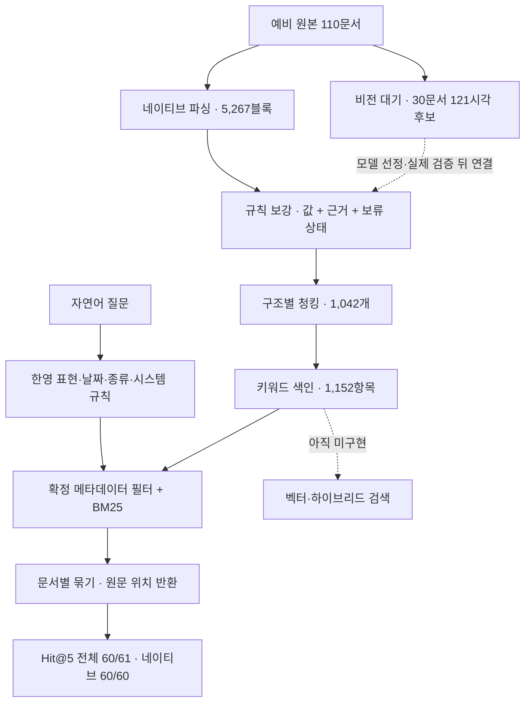

# RAG 전체 작업 현황과 문서 조건 검색 평가

작성: 2026-10-18 · 비교 기준일: 2026-10-17(Asia/Seoul) · 모델·유료 API 호출 없음

후속 결과: [작업명·핵심 필드·로그 문맥 개선 평가](../field-search-run-002/README.md)에서 Q-020 1위, Q-032 정답 3개 회수를 확인했다. 아래 수치는 이 버전의 당시 결과로 유지한다.

**이번 문서 종류·대상 시스템 조건 처리로 전체 60/61(98.36%), 네이티브 정답 질문 60/60(100%)의 Hit@5를 얻었습니다.** Q-020은 6위→2위, Q-034는 6위→1위이고 새 Hit@5 악화는 없습니다. 전체 검색의 90% 목표는 통과했지만 혼합형은 4/5(80%)로 미달합니다. 스캔·그림 이해와 전체 시스템의 완료를 뜻하지 않습니다.

## 1. 프로젝트 목적과 범위

Teams/SharePoint에 있는 거래처 문서를 찾아 **문서 링크·일치한 부분·원문 위치**를 보여주는 시스템입니다. 지금은 110개 합성 예비 파일을 로컬에서 시험합니다. 답변 생성은 선택 사항이며 필수 완료 조건으로 추가하지 않습니다. 인수인계서에서 전 직원 공개 자료를 대상으로 권한 필터는 적용하지 않기로 했습니다. 따라서 과거 보고서의 일반적인 ACL 미구현 표기는 이 프로젝트의 필수 후속 작업으로 해석하지 않습니다. OCR은 현재 경로에서 제외했고 이미지 해석은 비전 LLM 시험 대기입니다.

## 2. 지금까지 진행한 모든 작업 단계

| 단계 | 구현·검증한 내용 | 아직 하지 않았거나 제한된 내용 |
|---|---|---|
| 목적·구조 정리 | 인수인계서·파이프라인·예비 세트 확인, 문서 찾기 중심 범위 | 실제 Teams/SharePoint 연결 없음 |
| 평가기 | 필수 문자열·표 셀·메타데이터·청킹·검색 비교, JSON/보고서 | 개발 세트이며 독립 사내 검증 아님 |
| 공통 블록 | 형식별 내용을 공통 JSON으로 표현. 원문·표·위치·관계와 모델 해석 경계 설계 | 비전의 실제 응답·근거 정확도 검증 대기 |
| 네이티브 파싱 | DOCX/PPTX/XLSX/텍스트 PDF/TXT/LOG. 110문서, 5,267블록, 231/231단위 처리 | 스캔 3문서 본문 없음. 전체 표 의미·읽기 순서 독립 검수 아님 |
| 원문 보존·표 검사 | 비스캔 필수 문자열 334/334, 표본 24영역 531/531셀, 스키마·원본 해시 110/110 | 스캔 필수 문자열 12개 미추출. 표본 밖 전수 의미 정확도 아님 |
| 시각 자료 준비 | PDF 73쪽+PPTX 85장=158장 렌더링. 한글 누락 보완, 대표 시험 7장 준비 | 30문서·121시각 후보 대기. 이미지 생성은 의미 해석 완료가 아님 |
| 규칙 문서 보강 | 종류·거래처·번호·날짜·금액·시스템·로그 상태 등 근거 있는 값과 보류 상태 저장 | 의미 기반 계약유형·요약·사본·최신본 미구현, 라벨 불일치 검토 필요 |
| 청킹 | 조항·페이지·슬라이드·표 행·로그 시간 기준 1,042청크. 원문 범위와 문맥 분리 | 문자 제한 1,200자이며 모델 토큰 제한 검증 아님 |
| 표 헤더·청크 검증 | 91표의 명확한 열 이름 헤더 연결, 원문 문자 누락/필수 문자열 잘림 0 | 헤더의 독립 의미 검수와 복잡한 실제 양식 검증 필요 |
| 로컬 색인·검색 | 청크 1,042+문서 메타데이터 110=1,152항목. BM25, 전체 점수 후 문서 묶기, 위치 반환 | 벡터·하이브리드·형태소 분석기·운영 DB/웹 검색 UI 미구현 |
| 한영 표현·날짜 | 22개 운영 개념 연결, 식별자 구성요소, 절대/상대 날짜·명시 실행결과 조건 | 일반 번역/의미 추론 아님. 모호한 계약 연도·복수 날짜 등 보류 |
| 이번 문서 조건 | 명시된 문서 종류·12개 대상 시스템 어휘를 기존 조건과 AND 결합 | 복수 시스템·종류/부정/인용을 자동 추론하지 않음 |
| 재현·안전한 비교 | 원본·기존 결과 보존, 검색 중 파일·네트워크 차단, 질문별 순위와 근거 저장 | 이 검사는 검색 조건 전체의 의미적 진실을 증명하지 않음 |

## 3. 흐름도

## 4. 네이티브 성공이 해결한 문제

네이티브는 파일 안에 저장된 글자·문단·셀을 직접 읽는 범위입니다. 파일명과 경로도 활용하지만 이미지 안의 글자·사진 상황·구성도 연결선을 읽은 것은 아닙니다.

| 성공 종류 | 해결한 문제 | 뜻하지 않는 것 |
|---|---|---|
| 파싱 성공 | 여러 형식의 원문을 공통 블록과 위치로 보존, 검사한 문자열/셀 누락 제거 | 그림 의미·모든 표 구조를 완전히 이해함 |
| 보강 성공 | 명시적 표식에서 메타데이터를 규칙과 근거로 추출 | 모든 필드가 채워졌거나 정답과 전부 일치함 |
| 청킹 성공 | 원문을 검색 크기로 나눠도 검사 문자열·참조를 보존 | 모델 토큰 길이·모든 의미 단위 경계 검증 |
| 표현·날짜 검색 개선 | 한영 표기 불일치, 작년/올해·월 조건을 검색에 반영 | 모든 동의어·모든 날짜 문장 해석 |
| 이번 종류·시스템 개선 | 로그 요청에 제안서/견적서가 먼저 나오는 문제를 줄임 | 작업 내용까지 모두 맞는 결과만 반환함 |
| 네이티브 Hit@5 100% | 60개 질문 모두 네이티브 정답 문서 하나 이상이 상위 5개에 있음 | 정답 전부 발견·1위 정확도·답변 정확도가 100% |

네이티브 정답이 1위인 질문은 **55/60**입니다. Q-020은 정답 전환 로그가 2위이며 1위는 TMS 백업 로그입니다. 따라서 필터는 종류·시스템을 맞췄지만 “전환 작업”의 의미까지 확인한 것은 아닙니다.

## 5. 검색 성적의 변화

| 단계 | 전체 Hit@5 | 네이티브 정답 Hit@5 |
|---|---:|---:|
| 최초 키워드 기준선 | 53/61 = 86.89% | 53/60 = 88.33% |
| 한영·날짜 개선 후 | 58/61 = 95.08% | 58/60 = 96.67% |
| 이번 문서 종류·시스템 후 | 60/61 = 98.36% | 60/60 = 100% |

이번 효과를 분리해 측정했습니다. **문서 종류만 적용해도 두 실패가 모두 개선**됐습니다. 시스템만 적용한 결과는 전체 성공 수가 이전과 같았습니다. 따라서 이번 성공 수 증가는 주로 문서 종류 처리의 효과이며 두 기능 모두가 반드시 필요했다고 주장하지 않습니다.

| 이번 설정 | 전체 Hit@5 | 네이티브 Hit@5 | 새 필터 적용 질문 |
|---|---:|---:|---:|
| 이전 그대로 | 58/61 (95.08%) | 58/60 (96.67%) | 0 |
| 종류만 | 60/61 (98.36%) | 60/60 (100.00%) | 37 |
| 시스템만 | 58/61 (95.08%) | 58/60 (96.67%) | 14 |
| 종류+시스템 | 60/61 (98.36%) | 60/60 (100.00%) | 38 |

| 유형 | 전체 Hit@5 | 네이티브 Hit@5 |
|---|---:|---:|
| 메타데이터형 | 19/19 (100.00%) | 19/19 (100.00%) |
| 번호형 | 16/16 (100.00%) | 16/16 (100.00%) |
| 의미형 | 21/21 (100.00%) | 21/21 (100.00%) |
| 혼합 | 4/5 (80.00%) | 4/4 (100.00%) |

전체 MRR@10은 0.9432입니다. 네이티브의 질문별 정답 문서 회수율 평균은 99.44%입니다. Hit@5와 별개로 정답 전부를 찾았는지 측정한 값입니다.

## 6. 실패·미완료 항목 전체

| 항목 | 현재 상태 | 원인/남은 작업 |
|---|---|---|
| Q-020 TMS 전환 작업 로그 | 5위 → 6위 → 이번 2위. Hit@5 실패 해결 | 백업 로그가 여전히 1위. 작업명·의미 조건 점수/근거 검증 필요 |
| Q-034 오토스케일링 테스트 로그 | 상위 10개 밖 → 6위 → 이번 1위. Hit@5 실패 해결 | 다른 종류 문서를 걸러 정답 로그 발견. 다른 자료 일반화 검증 필요 |
| Q-037 본사·대전 DR센터 전용회선 구성도 | 유일한 남은 Hit@5 실패, 정답 D-069 상위 10개 밖 | 스캔 원문을 읽지 못해 위치·회선 연결 내용이 색인에 없음. 비전 대기 |
| Q-025 CT-2025-0164 | Hit@5 성공. 네이티브 D-043 발견 | 다른 정답인 스캔 D-044까지 찾지는 못함 |
| Q-032 자동으로 서버 늘리는 구성 | Hit@5 성공. 네이티브 정답 3개 중 2개가 상위 5개 | D-061 미포함. 정답 전체 회수와 후보/순위 품질 개선 필요 |
| 스캔 본문 3문서 | D-044·D-069·D-102 본문 청크 없음 | 필수 문자열 12개, 스캔 표의 행·열·의미 복원 미실행 |
| 그림·사진·도형 관계 | 30문서·121시각 후보 대기 | 노드·연결선·표/사진 의미와 비전 근거 정확도 평가 필요 |
| 메타데이터 정답 불일치 16건 | 날짜 5건·대상시스템 11건 | 원문/정답 정의 독립 검수. 임의 수정 안 함 |
| 미확정 보강 필드 | 비전 대기 75, 검토 대기 13, 네이티브에서 미발견 160 | 160은 원문에 없다고 확정한 값이 아님. 별도 적용 제외 1,072 |
| 계약유형·요약·사본·최신본 | 의미 기반 처리/정책 미구현 | 필요성과 기준을 정하고 따로 평가 |
| 실제 토큰 길이 | 문자 1,200자 기준만 확인 | 모델/토크나이저 선정 후 문맥 포함 길이 재검사 |
| 벡터·하이브리드·재순위화 | 미구현 | 모델 선정/필요성 비교 후 별도 검색 평가 |
| 질문 전체 조건 검증 | 미구현, conditions_verified=false | 적용된 필터 일치와 내용 조건 충족을 구분 |
| 수집·운영 연결 | 실제 SharePoint 추가/수정/삭제 동기화, 링크/UI, 운영 저장소 미구현 | 현재 파일 스냅샷 재생성만 시험 |
| 운영 모델·독립 검증 | OpenRouter 실제 비교, DGX 전환 시험 미실행 | 개발 세트 통과를 운영 완료로 보지 않음 |

모델 없이 추가로 진행할 수 있는 것은 작업명/핵심 필드 가중치, 로그 문맥 연결, 정답 전부 회수 평가, 사본·버전 정책, 메타데이터 검수 등입니다. 스캔·그림 의미 해석은 별도의 비전 시험이 필요합니다.

## 7. 메타데이터 전체 필드별 현황

채운 값의 정답 일치율은 864/880=98.18%, 정답 값 회수율은 864/924=93.51%입니다. 기존 날짜·금액·번호 전체 모집단 기준은 91.85%로 원래 95% 목표 미달입니다. 이번 검색 개선이 이 보강 성적을 바꾸지는 않았습니다.

| 필드 | 채움 | 정답 일치 | 비전 대기 | 검토 대기 | 미발견 | 적용 제외 |
|---|---:|---:|---:|---:|---:|---:|
| 문서종류 | 110 | 110 | 0 | 0 | 0 | 0 |
| 거래처 | 110 | 110 | 0 | 0 | 0 | 0 |
| 문서일자 | 94 | 89 | 3 | 13 | 0 | 0 |
| 대상시스템 | 109 | 98 | 1 | 0 | 0 | 0 |
| 상태 | 33 | 33 | 27 | 0 | 50 | 0 |
| 계약번호 | 24 | 24 | 2 | 0 | 0 | 84 |
| 계약유형 | 0 | 0 | 2 | 0 | 24 | 84 |
| 계약시작일 | 24 | 24 | 2 | 0 | 0 | 84 |
| 계약종료일 | 24 | 24 | 2 | 0 | 0 | 84 |
| 금액 | 57 | 57 | 2 | 0 | 0 | 51 |
| 통화 | 57 | 57 | 2 | 0 | 0 | 51 |
| VAT | 54 | 54 | 2 | 0 | 3 | 51 |
| 견적번호 | 22 | 22 | 29 | 0 | 59 | 0 |
| 견적유효기간 | 20 | 20 | 0 | 0 | 0 | 90 |
| 사이트 | 17 | 17 | 1 | 0 | 0 | 92 |
| 작업명 | 29 | 29 | 0 | 0 | 0 | 81 |
| 로그시작 | 29 | 29 | 0 | 0 | 0 | 81 |
| 로그종료 | 29 | 29 | 0 | 0 | 0 | 81 |
| 실행결과 | 29 | 29 | 0 | 0 | 0 | 81 |
| 오류코드 | 9 | 9 | 0 | 0 | 24 | 77 |

사업명은 추가 보조 필드이며 기존 20개 필드 정답 점수의 분모에는 들어가지 않습니다.

## 8. 61개 질문 전체 결과

아래 순위는 정답 문서 중 가장 먼저 나온 위치입니다. “10위 밖”에는 검색 결과 없음도 포함됩니다. 성공은 5위 이내이며 정답 문서 전부의 발견 여부는 별도입니다.

| ID | 질문 | 최초 키워드 | 한영·날짜 후 | 이번 | 상태 |
|---|---|---:|---:|---:|---|
| Q-001 | 청람정밀 MES 고도화 계약서 | 1 | 1 | 1 | 상위 5개 성공 |
| Q-002 | CT-2025-0112 | 1 | 1 | 1 | 상위 5개 성공 |
| Q-003 | 설비 데이터를 1초 단위로 수집하겠다고 제안한 문서 | 1 | 1 | 1 | 상위 5개 성공 |
| Q-004 | 청람 화성 공장 OT 설비망 IP 대역 | 1 | 1 | 1 | 상위 5개 성공 |
| Q-005 | mes-db01 서버 사양 | 1 | 1 | 1 | 상위 5개 성공 |
| Q-006 | ORA-01555 오류 난 배치 로그 | 1 | 1 | 1 | 상위 5개 성공 |
| Q-007 | Cheongram Precision 견적 최종본 | 1 | 1 | 1 | 상위 5개 성공 |
| Q-008 | 청람정밀 2025년 ERP 유지보수 계약 | 1 | 1 | 1 | 상위 5개 성공 |
| Q-009 | 장애 나면 4시간 안에 현장에 와야 하는 계약 | 1 | 1 | 1 | 상위 5개 성공 |
| Q-010 | BKP-E1042 | 1 | 1 | 1 | 상위 5개 성공 |
| Q-011 | ERP 백업 디스크 부족 관련 고객 통화 메모 | 1 | 1 | 1 | 상위 5개 성공 |
| Q-012 | 다온로지스 평택 WMS 견적서 | 1 | 1 | 1 | 상위 5개 성공 |
| Q-013 | Q-2504-02 | 1 | 1 | 1 | 상위 5개 성공 |
| Q-014 | 소터 연동이 포함된 물류센터 구축 계약 | 5 | 5 | 1 | 상위 5개 성공 |
| Q-015 | PDA 무선망 대역 알려줘 | 1 | 1 | 1 | 상위 5개 성공 |
| Q-016 | NET-E0110 타임아웃 | 1 | 1 | 1 | 상위 5개 성공 |
| Q-017 | WMS 2.3.0 배포 때 헬스체크 느렸던 기록 | 10 | 1 | 1 | 상위 5개 성공 |
| Q-018 | 다온물류 TMS 이전 계약서 | 1 | 1 | 1 | 상위 5개 성공 |
| Q-019 | 임대 IDC 계약 만료 때문에 서버 옮기자고 한 제안 | 1 | 1 | 1 | 상위 5개 성공 |
| Q-020 | TMS 전환 작업 로그 | 5 | 6 | 2 | 상위 5개 성공 |
| Q-021 | tms-db01 IP 주소 | 1 | 1 | 1 | 상위 5개 성공 |
| Q-022 | 새봄병원 PACS 스토리지 증설 계약서 서명본 | 1 | 1 | 1 | 상위 5개 성공 |
| Q-023 | 스토리지 300TB 늘리는 제안 | 1 | 1 | 1 | 상위 5개 성공 |
| Q-024 | Brocade SAN 스위치 들어간 구성도 | 1 | 1 | 1 | 상위 5개 성공 |
| Q-025 | CT-2025-0164 | 1 | 1 | 1 | 상위 5개 성공 |
| Q-026 | 새봄의료재단 EMR 유지보수 계약 | 1 | 1 | 1 | 상위 5개 성공 |
| Q-027 | 2시간 안에 원격 대응 시작하기로 한 유지보수 계약 | 1 | 1 | 1 | 상위 5개 성공 |
| Q-028 | BKP-E2210 테이프 드라이브 오류 | 1 | 1 | 1 | 상위 5개 성공 |
| Q-029 | EMR 테이프 백업 문제로 고객이 요청한 내용 메모 | 1 | 1 | 1 | 상위 5개 성공 |
| Q-030 | emr-db02 IP | 5 | 5 | 5 | 상위 5개 성공 |
| Q-031 | 미르내대 학사정보시스템 클라우드 전환 견적 | 1 | 1 | 1 | 상위 5개 성공 |
| Q-032 | 수강신청 몰릴 때 자동으로 서버 늘리는 구성 | 1 | 1 | 1 | 상위 5개 성공 |
| Q-033 | 10.54.128.0/17 | 1 | 1 | 1 | 상위 5개 성공 |
| Q-034 | 오토스케일링 테스트 로그 | 10위 밖 | 6 | 1 | 상위 5개 성공 |
| Q-035 | 도담캐피탈 DR 구축 계약서 | 1 | 1 | 1 | 상위 5개 성공 |
| Q-036 | RTO 3시간 RPO 15분 목표로 한 제안 | 1 | 1 | 1 | 상위 5개 성공 |
| Q-037 | 본사랑 대전 DR센터 전용회선 구성도 | 10위 밖 | 10위 밖 | 10위 밖 | 실패·비전 대기 |
| Q-038 | loan-db-dr01 | 3 | 1 | 1 | 상위 5개 성공 |
| Q-039 | Data Guard 전환 훈련 결과 | 10위 밖 | 2 | 2 | 상위 5개 성공 |
| Q-040 | 해솔유통 온라인몰 이중화 제안서 | 1 | 1 | 1 | 상위 5개 성공 |
| Q-041 | L4 스위치 Active-Standby로 이중화한 구성도 | 1 | 1 | 1 | 상위 5개 성공 |
| Q-042 | 페일오버 테스트에서 502 에러 난 로그 | 10위 밖 | 1 | 1 | 상위 5개 성공 |
| Q-043 | mall-db02 | 1 | 1 | 1 | 상위 5개 성공 |
| Q-044 | 해솔마트 견적 관련 메일 | 1 | 1 | 1 | 상위 5개 성공 |
| Q-045 | 별하게임즈 게임서버 운영 대행 계약 | 1 | 1 | 1 | 상위 5개 성공 |
| Q-046 | 24시간 365일 관제 조건 있는 계약 | 1 | 1 | 1 | 상위 5개 성공 |
| Q-047 | 게임 로그 디스크 87% 경고 | 1 | 1 | 1 | 상위 5개 성공 |
| Q-048 | Anti-DDoS 장비 있는 네트워크 구성도 | 1 | 1 | 1 | 상위 5개 성공 |
| Q-049 | 별하게임즈 로그분석 라이선스 계약 | 1 | 1 | 1 | 상위 5개 성공 |
| Q-050 | 달러로 계약한 라이선스 | 1 | 1 | 1 | 상위 5개 성공 |
| Q-051 | Q-2509-02 | 1 | 1 | 1 | 상위 5개 성공 |
| Q-052 | 온새미도시공사 서버 교체 계약서 | 1 | 1 | 1 | 상위 5개 성공 |
| Q-053 | 부가세 포함 금액으로 견적 낸 공공기관 건 | 1 | 1 | 1 | 상위 5개 성공 |
| Q-054 | Windows Server 2012 R2 지원 종료 대응 제안 | 1 | 1 | 1 | 상위 5개 성공 |
| Q-055 | fms-gis01 | 1 | 1 | 1 | 상위 5개 성공 |
| Q-056 | 청람정밀 2026년 ERP 유지보수 계약 | 1 | 1 | 1 | 상위 5개 성공 |
| Q-057 | 3시간 이내 현장 도착 조건 계약 | 1 | 1 | 1 | 상위 5개 성공 |
| Q-058 | CT-2025-0402 | 1 | 1 | 1 | 상위 5개 성공 |
| Q-059 | 2025년 9월에 실패한 로그 | 9 | 1 | 1 | 상위 5개 성공 |
| Q-060 | 작년 12월 DB 백업 로그 | 10위 밖 | 1 | 1 | 상위 5개 성공 |
| Q-061 | 올해 돌린 백업 로그 | 10위 밖 | 3 | 3 | 상위 5개 성공 |

## 9. 검증과 파일

새 기능 회귀 검사 20개 통과. 기존 순위·점수 재현, 모든 반환 결과의 적용 필터 일치, 61개 전체 재검색 동일, 색인 불변을 확인했습니다. 기존 파서 13개·보강 27개·청킹 21개·한영/날짜 27개 검사는 해당 단계의 과거 기록이며 이번에 전부 다시 실행했다고 합산하지 않습니다.

비교의 공정성을 위해 날짜 기준일은 2026-10-17로 유지했습니다. 2026-10-18 기준으로 주요 날짜 질문과 두 대상 질문을 별도 실행했으며 문서 순위는 동일했습니다.

개발 세트의 원문/실패 관찰로 규칙을 개발했습니다. 정답과 기대 필터를 검색기에 전달하지 않았지만, 이 사실만으로 미공개 독립 평가가 되지는 않습니다.

- [실행 방법·구현](../rag-condition-search-v1/README.md), [사전 평가 규칙](../rag-condition-search-v1/CONTRACT.md)
- [평가 요약 JSON](evaluation/summary.json), [61질문 상세](evaluation/combined-query-results.json), [변화 목록](evaluation/changes.json)
- [검색 근거·조건 전체](evaluation/combined-search-results.jsonl), [검증 이력](verification.json), [입력·출력 해시](provenance.json)
- [Q-020 실제 결과](examples/Q-020.json), [Q-034 실제 결과](examples/Q-034.json), [Q-037 실패](examples/Q-037.json)
- [파싱 보고서](../parsing-run-003/README.md), [보강 보고서](../enrichment-run-001/README.md), [청킹 보고서](../native-search-run-002/README.md), [한영·날짜 보고서](../rule-search-run-004/README.md)
