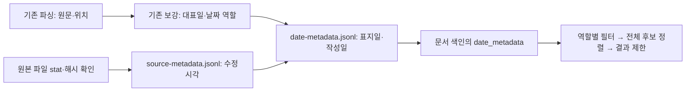

# 수정일 수집·날짜 역할 검색 및 후속 기준 정리 결과

2026-10-18 · 원본 110문서 · 유료 API/모델 호출 0.

## 완료한 작업

1. 110개 원본 파일을 파싱 당시 해시와 대조하고 최종 수정시각을 수집·저장했다. 수정일을 명시한 최신순/오래된순 검색과 한국 시간 기준 날짜 필터에 연결했다.
2. 표지일과 명시적 작성일을 분리해 검색한다. 작성일을 관찰하지 못했을 때 표지일이나 파일 수정일로 대체하지 않는다.
3. 메타데이터 기준과 29건의 원인·처리를 [별도 정답 버전](../metadata-policy-v1/README.md)에 정리했다.
4. [독립 평가 패키지·실행기](../independent-evaluation-prep-v1/README.md)를 준비했다. 실제 독립 자료 평가는 아직 실행하지 않았다.

## 날짜가 전달되는 과정

| 항목 | 저장 위치 | D-002의 값 |
|---|---|---|
| 기존 대표 날짜 | `enriched.jsonl`의 `fields.문서일자.value` | `2025-01-13` |
| 표지일 | `date-metadata.jsonl`의 `fields.표지일` | `2025-01-13`, extracted |
| 명시적 작성일 | 같은 파일의 `fields.작성일` | null, not_observed_native |
| 파일 최종 수정일 | 같은 파일의 `fields.파일최종수정일` | `2025-01-14T08:29:00.000000000Z` = 한국 시간 17:29 |
| 수정일 출처 | `source-metadata.jsonl`의 `origin` | local_filesystem_stat.st_mtime_ns |
| 검색용 저장 | `index.json`의 `documents["D-002"].date_metadata` | 같은 날짜·상태·근거 |

본문 날짜는 보강 단계에서 역할을 판단한다. 수정일은 원본 파일 속성에서 수집한다. 색인에서 서로 별도 필드로 사용하며 제출·승인 시각을 추정하지 않는다. 이 자료의 파일시각은 예비 데이터 생성기가 설정한 값이다.

## 실제 검색 예시

| 질문 | 현재 결과 | 확인한 동작 |
|---|---|---|
| 청람정밀 가장 최근에 수정된 제안서 | D-002 PDF → D-001 PPTX | 1월 14일 수정본이 1월 13일 수정본보다 앞섬 |
| 청람정밀 표지 날짜 2025년 1월 13일 제안서 | D-001, D-002 | 두 표지 날짜가 모두 13일 |
| 청람정밀 작성일 2025년 1월 13일 제안서 | 확정 결과 없음 | 표지 날짜를 명시적 작성일로 쓰지 않음. 미확인 문서는 별도 반환 |
| MES 작성일 2025년 2월 24일 네트워크 구성도 | D-007 | 원문 `작성일` 표기를 사용 |
| 청람정밀 2025년 2월 7일 수정된 계약서 | D-005 초안 | 수정일로 찾되 초안 작성일을 확정하지 않음 |
| 온라인몰 최신 수정순 제안서, 상위 2개 | D-075 → D-076 | 같은 날짜도 17:14와 17:10을 구분 |

## 기존 결과와 비교

| 검사 | 이전 | 이번 |
|---|---:|---:|
| 전체 61질문 Hit@5 | 60/61 = 98.36% | 60/61 = 98.36% |
| 네이티브 정답이 있는 60질문 Hit@5 | 60/60 = 100% | 60/60 = 100% |
| 네이티브 정답 전부를 상위 5개에서 회수 | 60/60 | 60/60 |
| 전체 정답 문서를 모두 상위 5개에서 회수 | 59/61 | 59/61 |
| 날짜·정렬 전용 개발 검사 | 6/20 | 20/20 |
| Q-020 / D-036 | 1위 | 1위 |
| Q-032 / D-054·D-053·D-061 | 1·2·3위 | 1·2·3위 |

기존 61질문의 모든 반환 문서 순위와 점수가 동일하다. 기존 보강 JSON과 청크 JSON도 바이트 단위로 동일하다. 90% 목표는 기존과 같이 충족하며, 이번에는 새 날짜 동작을 추가했다. 20개 날짜 검사는 양성 13개, 네이티브 확정 결과 없음 5개, 확인 필요 2개로 구성한 개발 검사다. 기존 61개와 합쳐 점수를 높이거나 독립 성능으로 표시하지 않는다.

[비교 지표](evaluation/summary.json) · [질문별 날짜 검사](evaluation/date-case-comparison.json) · [기존 61질문 결과](evaluation/query-results.json).

## 메타데이터 기준과 불일치

- 표지 날짜 5건과 시스템 11건, 총 16건을 원문 기준 정답 v1에 반영했다. 원본 gold는 보존했다.
- 초안 작성일 13건은 본문에 근거가 없어 계속 미확정이다. 수정일을 수집했어도 작성일로 대체하지 않았다.
- 같은 추출 결과를 원본 정답으로 채점하면 864/880 = 98.18%, 원문 기준으로 채점하면 880/880 = 100%다. 값 회수율은 864/924 = 93.51%와 880/922 = 95.44%다.
- **이 점수 차이는 기준·라벨 정리 효과다.** 16개 기대값을 바꾸고 근거 없는 13개 날짜를 값 평가 미확정으로 분리했으므로 분모도 다르다. 13건을 성공으로 세지 않았으며 보류 상태 13/13 유지를 별도로 확인했다.

전체 [24개 필드 사전](../metadata-policy-v1/field-dictionary.json), [29건 처리 근거](../metadata-policy-v1/label-adjustments.json), [두 기준의 점수](../metadata-policy-v1/comparison.json)를 남겼다.

## 검증 범위와 남은 작업

새 단위 검사 19개와 기존 보강 검사 46개가 통과했다. 150개 후보에서 먼저 전체 정렬하고 마지막에 limit을 적용하는 검사, 한국 날짜의 UTC 경계, 나노초·동률·누락 시각, 원본 해시와 경로 검사를 포함한다. 실제 110문서의 수정일을 기록했고 추출·색인·검색 중 외부 입출력 차단 상태에서 동작을 확인했다.

독립 평가 실행기는 별도 합성 30문서·60질문으로 수집부터 평가 파일 출력까지 동작을 확인했다. 이는 실행기 점검이며 실제 독립 정확도 측정이 아니다. 빈 양식은 평가 통과로 처리하지 않는다.

남은 항목:

1. 초안 13건의 실제 작성일을 확정할 수 있는 별도 원천 근거. 현재는 안전하게 보류한다.
2. 사용하지 않은 새 원본과 사람이 따로 검수한 정답을 받아 독립 평가 실행. 준비 규격은 최소 30문서·60질문이다.
3. 비전 모델 비교·미처리 시각 내용 검증. 유료 시험은 계속 보류했다.
4. 운영 시 원본 저장소의 수정시각 수집 및 자동 갱신 연결. 이번 구현은 로컬 예비 데이터셋의 수정시각을 사용한다.

[재실행·검색 명령](../rag-date-search-v1/README.md) · [실행 입력/출력 해시](provenance.json) · [최종 검증 기록](verification.json).
