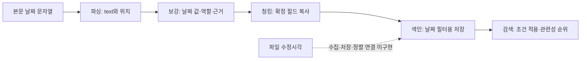

# 현재 날짜 기준과 단계별 저장 위치

2026-10-18 · 실제 코드와 현재 JSON 산출물을 확인한 설명 · 모델/API 호출 없음.

## 적용 기준과 이번 수정 범위

- `문서일자`는 본문에서 확인한 대표 날짜를 유지한다. 표지 날짜가 곧 작성일이라는 뜻은 아니다.
- 파일 최종 수정일은 원본 파일·저장소에서 수집할 별도 정보다. 현재 파이프라인에는 수집·저장·최신순 정렬이 구현되어 있지 않다.
- 원문 근거 없는 제출일 해석과 이를 전제로 한 검토 제안을 제거했다. 제출일을 필수 필드로 추가하지 않는다.
- 이번 변경은 보고서·검토 목록·감사 분류명·보고서 생성 문구의 수정이다. 원본 문서, 원본 gold, 파싱/보강/청킹/색인/검색 결과 및 실행 당시 계약은 보존했다. 원본 생성 코드 인용과 과거 실행 스냅샷은 감사 증거로 남긴다.

## 단계별로 실제 기록되는 내용

| 단계 | 현재 파일과 필드 | 의미 / D-002 예시 |
|---|---|---|
| 파일 식별·수집 준비 | `parsing-run-003/manifest.jsonl`: `doc_id`, `relative_path`; 파싱 결과의 `source` | 파일명·형식·경로·해시 등. **파일 수정일 필드는 없음** |
| 파싱 | `parsing-run-003/parsed.jsonl`: `blocks[].text`, `blocks[].cells[].text`, `blocks[].loc`, `blocks[].evidence` | 날짜를 포함한 원문과 위치를 보존. D-002 1페이지의 `2025. 01. 13. \| 라움정보기술 주식회사` |
| 로그 파싱 | 같은 파일의 `blocks[].log.timestamp_raw`, `blocks[].log.timezone` | 각 로그 줄의 원문 시각. 현재 `timezone`은 null로 원문에 없는 시간대를 만들지 않음 |
| 문서 보강 | `enriched.jsonl`: `fields[필드명].value/status/rule_id/evidence/candidates/reason` | 날짜의 역할을 판단해 검색용 값과 근거·보류 상태를 저장. D-002 `fields.문서일자.value = "2025-01-13"` |
| 날짜 역할 기록 | `enriched.jsonl`: `date_context.observations[]`, `selected_roles`, `selection_reason` | D-002는 `role = "cover_date"`, `value = "2025-01-13"`. 작성일로 단정하지 않음 |
| 청킹 | `chunks.jsonl`: 문서 수준 및 `chunks[].filter_metadata`, `metadata_statuses`; `chunks[].context_header` | 보강에서 `extracted`인 값만 복사. D-002의 문맥 머리말에 `문서일자=2025-01-13` 포함 |
| 색인 | `index.json`: `documents[doc_id].metadata`, `metadata_statuses`; `entries`의 텍스트·문맥 머리말 | D-002 `documents["D-002"].metadata.문서일자 = "2025-01-13"`. 날짜를 새로 결정하지 않음 |
| 질문 해석 | `evaluation/search-results.jsonl`: `query_plan.filters[]`, `recognized`, `reference_date`, `timezone` | 질문의 날짜 조건을 `{field, op, value}` 필터로 변환. `reference_date`는 상대 날짜 해석 기준일 |
| 검색 결과 | 같은 파일의 `results[].metadata`와 근거의 `context_header` | 색인의 날짜 메타데이터를 결과에 포함. 현재 순서는 검색 관련성 점수순이며 수정일순이 아님 |

`enriched.jsonl`, `chunks.jsonl`, `index.json`, `evaluation/search-results.jsonl`은 이 안내와 같은 `metadata-review-run-002` 폴더에 있다. 날짜 역할 목록 전체인 `date_context`는 현재 청크·색인으로 전달되지 않으며, 역할별 검색 필터도 아직 없다.

## 문서 보강의 날짜 관련 필드 6개

모두 `fields[필드명]` 아래에 저장한다. `value`만 저장하는 것이 아니라 원문 위치와 인용을 담은 `evidence`, 추출 상태인 `status` 등을 함께 보관한다.

| 필드 | 의미 | 값 형식 | 현재 110문서의 상태 |
|---|---|---|---|
| `문서일자` | 해당 문서에서 규칙으로 선택한 대표 날짜 | `YYYY-MM-DD` | 추출 94 / 검토 대기 13 / 비전 대기 3 |
| `계약시작일` | 본문에 명시된 계약기간의 시작일 | `YYYY-MM-DD` | 추출 24 / 비전 대기 2 / 적용 대상 아님 84 |
| `계약종료일` | 본문에 명시된 계약기간의 종료일 | `YYYY-MM-DD` | 추출 24 / 비전 대기 2 / 적용 대상 아님 84 |
| `견적유효기간` | 현재 규칙에서는 견적의 유효 종료 날짜 | `YYYY-MM-DD` | 추출 20 / 적용 대상 아님 90 |
| `로그시작` | 명시적 작업 시작 또는 점검 구간의 시작 시각 | `YYYY-MM-DD HH:MM` | 추출 29 / 적용 대상 아님 81 |
| `로그종료` | 명시적 작업 종료 또는 점검 구간의 종료 시각 | `YYYY-MM-DD HH:MM` | 추출 29 / 적용 대상 아님 81 |

`로그시작/로그종료`는 현재 분 단위 값이며 시간대 오프셋을 포함하지 않는다. 초가 있는 원문은 파싱 블록에 남아 있다. 모든 본문 날짜를 이 6개 필드로 변환하는 것은 아니다. 예를 들어 제안서의 추진 일정은 원문 블록에 보존되지만 계약기간 필드로 자동 분류하지 않는다.

## 날짜 역할과 보류

현재 107문서에서 날짜 관찰 155개가 기록되어 있다. 스캔 3문서는 날짜 관찰을 생성하지 않았다.

- `cover_date`: 표지 날짜 — 13개
- `quote_date`: 견적일자 — 20개
- `explicit_written_date`: 명시적 작성일 — 13개
- `email_sent_date`: 메일 Date 헤더의 날짜 — 2개
- `execution_start_date`, `inspection_date`: 작업 시작일 25개, 점검일 4개
- `memo_date`, `diagram_header_date`: 메모 날짜 2개, 구성도 머리말 날짜 4개
- `signing_block_printed_date`: 체결부에 인쇄된 날짜 — 24개
- `contract_period_start`, `contract_period_end`: 계약 시작일·종료일 — 각각 24개

스키마는 명시적 `문서일자` 라벨을 뜻하는 `explicit_document_date`도 지원하지만 현재 자료의 관찰 건수는 0이다. 관찰마다 `value`, `rule_id`, `evidence`, `assertion: "source_statement_only"`를 가진다. 이 목록은 모든 원문 날짜를 수집한 목록이 아니라 지원하는 규칙으로 식별한 날짜 역할이다. 견적 유효 종료일과 로그 종료 시각은 위의 독립 필드에 저장되며 별도의 관찰 역할로 중복 추가하지 않는다.

D-005 같은 초안에서는 체결부 날짜를 관찰값으로 보존해도 `fields.문서일자.value`는 null, `status`는 `needs_review`다. 인쇄된 체결부 날짜만으로 실제 작성일이나 실제 서명 완료일을 확정하지 않는다.

## D-002의 13일과 14일은 현재 어디에 있는가

| 값 | 현재 위치 | 현재 검색에 미치는 영향 |
|---|---|---|
| `2025-01-13` | 원문 표지 → 파싱 블록 → `fields.문서일자` → 청크와 색인의 `문서일자` | 문서일자 필터·메타데이터·문맥 머리말에 사용 |
| `2025-01-14 17:29 +09:00` | 원본 PDF의 파일시스템 수정시각. 예비 데이터 생성기가 설정한 값 | 현재 파싱의 `source`에 수집하지 않아 수정일 필터·정렬에 사용되지 않음 |
| `2025-01-14` | 원본 `gold/documents.jsonl`의 D-002 `문서일자` | 평가용 기대값으로만 사용. 현재 추출값과 달라 불일치로 집계 |

원본 gold를 색인 값으로 복사하지 않는다. 14일을 근거 없는 업무 날짜로 해석하지 않으며 파일 수정시각과 본문 대표일을 별도로 다룬다. 이번 문구 수정으로 정답 라벨·평가 점수는 바뀌지 않는다.

## 현재 검색에서 날짜를 해석하는 범위

- 명시적 `문서일자` 또는 `작성일` 표현 → 현재는 모두 `문서일자` 필드로 연결한다. **따라서 ‘작성일’ 질문에 대해서도 표지 날짜와 명시적 작성일을 구분하는 역할 필터는 아직 없다.**
- `계약 시작일`, `계약 종료일/만료일`, `로그 종료`, 일반 로그 날짜 → 각각 계약시작일, 계약종료일, 로그종료, 로그시작으로 연결한다.
- 해당 날짜·월·연도의 시작과 끝을 `gte/lte` 조건으로 만든다. `견적유효기간`은 직접 지정하는 구조화 필터로 처리할 수 있으나 현재 자연어 날짜 규칙에 전용 연결은 없다.
- `가장 최근 수정된 문서`는 수정일 필터·최신순 정렬로 구현되어 있지 않다. `최근` 표현은 지원하지 않는 날짜 표현으로 경고하며 검색 관련성 점수순 결과가 최신순이라는 보장은 없다.
- `query_plan.reference_date = "2026-10-17"`은 기존 비교 실행에서 고정한 질문 해석 기준일이다. 문서 작성일이나 수정일이 아니다.
- 파싱 실행 기록의 `provenance.json.measured_at_utc`, 다른 실행 기록의 `created_at_utc` 역시 프로그램 실행 시각이며 문서 날짜가 아니다.

## 확인한 구현과 산출물

- [공통 블록 생성](../rag-parser-v3/parse.py): `Builder.__init__`, `add`, 로그 `timestamp_raw` 변환
- [날짜 보강](../rag-enrichment-v2/enrich.py): `dates`, `schema`; [기본 날짜 규칙](../rag-enrichment-v1/enrich.py)
- [청킹·색인·구조화 필터](../rag-native-search-v1/pipeline.py): `make_chunks`, `build_index`, `apply_filters`
- [질문의 날짜 조건](../rag-rule-search-v1/search.py): `plan`; [최종 검색·정렬](../rag-field-search-v1/field_search.py): `search`
- [D-002 보강 결과](examples/D-002.json), [원문 대조](source-audit.json), [현재 판단 목록](REVIEW_QUEUE.md)
