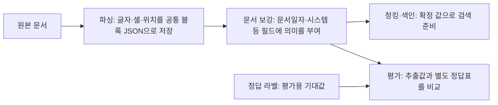

# 메타데이터 기준·라벨 불일치·날짜 모호성 검토

2026-10-18 · 원문 110문서 보존 · 기존 정답 보존 · 모델/유료 API 호출 없음.

**16건의 라벨 불일치와 13건의 날짜 보류는 파싱 글자 손상이나 색인 오류로 확인되지 않았다.** 원문과 평가 정답의 날짜 기준 차이, 생성기의 시스템 N/A 고정, 본문에 쓰지 않은 초안 작성일이 원인이다. 29건을 모두 원문과 다시 대조하고 생성 코드는 원인 조사에만 사용했다.

현재 날짜 기준과 단계별 JSON 필드는 [날짜 필드 안내](DATE_FIELDS.md)에 정리했다. 근거 없는 제출일 해석은 제거했으며, 파일 수정일을 본문 날짜로 대체하지 않는다.

## 어느 단계의 문제인가

JSON은 저장 형식이다. 날짜 문자열을 올바르게 저장했어도 ‘표지일인지 작성일인지’에 대한 정의는 별개다. 이번 차이는 주로 **문서 보강의 필드 정의와 평가 정답 기준 사이**에서 발견됐다. 색인은 이 값을 받아 사용하므로 상류의 잘못된 판단이 검색에 영향을 줄 수 있지만, 이번 29건에서 색인이 날짜나 시스템명을 바꿔 저장한 증거는 없다.

## 원인을 확인한 실제 예시

| 종류 | 원문에서 확인한 내용 | 기존 정답 | 확인된 원인·현재 처리 |
|---|---|---|---|
| 날짜 불일치 5건 | D-002 표지 `2025. 01. 13.` → 추출 `2025-01-13` | `2025-01-14` | 생성기에서 PDF 정답 날짜를 표지 날짜+1일로 등록. 원문 표지일을 유지하며 파일 최종 수정일은 별도 항목으로 다룸 |
| 시스템 불일치 11건 | D-007 제목 `2025 MES 고도화 구축 네트워크 구성도 (Rev.1)` → `MES` | `N/A` | 구성도·관련 메일 생성기가 대상시스템을 N/A로 고정. 원문에 있는 시스템 추출을 유지 |
| 초안 날짜 보류 13건 | D-005 체결부에 `2025년 2월 19일`, 문서에 초안 표기 | 문서일자 `2025-02-07` | 생성기 내부에서 초안일을 체결부 표기일-12일로 설정했지만 그 작성일은 본문에 없음. 문서일자는 null/needs_review 유지 |

D-005의 계약기간 시작일 `2025-03-01`도 별도로 적혀 있다. 이를 문서 작성일이나 실제 계약 체결일로 대체하지 않는다. 13개 초안의 정답 날짜가 본문에 없다는 판단은 DOCX 원본 XML을 읽어 날짜를 대조한 결과이며, 파일시각·외부 업무시스템에 그 날짜가 절대 없다는 뜻은 아니다.

5개 PDF 표지는 실제 원본을 다시 렌더링해 날짜를 눈으로 확인했다. 시스템명은 PPTX 원본 XML과 TXT 원문·파일명으로 대조했고, 13개 초안은 DOCX 원본 XML의 날짜와 체결부 문맥을 확인했다. 기존 파싱 인용문이 직접 읽은 원문과 모두 일치했다. [29건 원문 대조](source-audit.json), [생성 코드 원인·행 번호](generator-audit.json), [판단 목록](REVIEW_QUEUE.md).

## 규칙으로 확실히 개선한 부분

1. **날짜 역할 저장:** 표지일·작성일·메일일·체결부 표기일·계약기간을 `date_context`로 분리했다. 네이티브 107문서의 날짜 관찰 155개를 출처와 함께 기록했다. 스캔 3문서의 날짜를 새로 만들지 않았다.
2. **역할이 다른 날짜의 분리:** 명시적인 작성일이 있는 초안은 그 날짜를 사용하고 체결부 날짜를 별도로 보존한다. 같은 역할의 충돌이나 잘못된 날짜는 계속 보류한다.
3. **머리말 작성일 보존:** `설치 위치: … | 작성일: …` 및 XLSX의 여러 공백으로 구분된 머리말을 지원한다.
4. **메일 시스템 근거 보강:** 파일명뿐 아니라 현재 메일 Subject 원문을 근거로 연결한다. 전달 메일과 본문 언급을 대상 시스템으로 자동 채택하지 않는다.

실제 평가 필드의 값·상태 변경은 **0건**이다. 50개 필드의 규칙/인용/보류 사유가 달라졌고 날짜 역할이 추가됐다. 이는 잘못된 값을 50개 고쳤다는 뜻이 아니다.

명시적 작성일을 추가한 초안, 시스템명이 없는 파일명과 명시적 메일 제목, 본문에 우연히 등장한 날짜 라벨 등 변형 입력에서는 개선 동작을 검사했다. 이들은 **합성 변형 검사**이며 실제 13개 초안에서 작성일을 발견한 결과로 집계하지 않았다. [변형 사례 전후 비교](synthetic-rule-checks.json).

## 기존 결과와 비교

| 지표 | 이전 | 이번 최종 실행 |
|---|---:|---:|
| 메타데이터 스키마·원문 근거 검사 | 110/110 | 110/110 |
| 채운 메타데이터의 정답 일치율 | 864/880 = 98.18% | 864/880 = 98.18% |
| 정답 값 회수율 | 864/924 = 93.51% | 864/924 = 93.51% |
| 기존 정답과 불일치 | 16건 | 16건 유지 |
| 날짜 검토 대기 | 13건 | 13건 유지 |
| 전체 검색 Hit@5 | 60/61 = 98.36% | 60/61 = 98.36% |
| 네이티브 정답을 모두 상위 5개에서 찾은 질문 | 60/60 | 60/60 |
| 전체 첫 결과가 정답인 질문 | 59/61 | 59/61 |
| Q-020의 정답 D-036 | 1위 | 1위 |
| Q-032 정답 D-054·D-053·D-061 | 1·2·3위 | 1·2·3위 |

비교 기준일은 2026-10-17로 고정했다. 청크와 색인을 실제로 다시 생성했다. 색인 내용은 이전과 동일했고, 61개 질문의 문서 순위와 점수도 동일했다. 메타데이터 정답을 바꾸거나 29건을 평가에서 빼서 점수를 높이지 않았다. [전체 비교 JSON](comparison.json), [메타데이터 평가](evaluation/report.md), [검색 결과](evaluation/query-results.json).

## 판단을 남긴 항목

- **날짜 5건:** 문서일자는 원문 표지일로 유지하고 파일 최종 수정일은 별도 항목으로 다룬다. 수정일 수집·검색 연결 및 기존 정답의 날짜 기준 변경은 아직 실행하지 않았다.
- **시스템 11건:** 인수인계서의 ‘문서에 있을 때’ 기준이라면 원문 시스템명을 정답에 반영하는 것이 타당해 보인다. 별도 정답 버전의 검수·확정 전에는 원본 gold를 바꾸지 않는다.
- **초안 13건:** 실제 작성일 근거를 추가하거나, 본문 추출만 평가하는 정답 정의를 변경할지 판단해야 한다. 당장은 문서일자 보류와 체결부 표기일 보존을 유지한다.

사람이 확정한 변경은 이후 별도 정답 버전이나 업무 메타데이터로 기록해야 한다. 생성기 전용 날짜 산술을 추출 규칙에 넣거나 실제 서명 확인 없이 체결 완료를 단정하지 않는다.

## 검증·파일

기존 보강 검사 27개와 새 검사 19개, **총 46개 통과**. 실제 110문서 검증, 추출/검색 재실행 일치, 원본 110개 및 기존 산출물 해시 보존, 검색 중 외부 입출력 시도 0을 확인했다. [검증 기록](verification.json), [실행 해시](provenance.json).

첫 실행에서 구성도 복합 머리말의 작성일 13개를 놓치는 문제가 있었으며 [첫 실행](../metadata-review-run-001/comparison.json)과 당시 구현을 보존했다. 해당 형식을 보완하고 단위 검사·전체 평가를 다시 실행한 결과가 이 보고서다.

- [새 메타데이터 JSONL](enriched.jsonl), [새 스키마](enrichment.schema.json)
- [실제 D-005 초안 JSON](examples/D-005.json), [실제 D-030 메일 JSON](examples/D-030.json)
- [메타데이터 기준·재현 방법](../rag-enrichment-v2/README.md)
- [모든 판단 대상 29건](REVIEW_QUEUE.md), [판단 대상 JSON](review-decisions.json)

비전·임베딩·유료 API는 사용하지 않았다. 이번 결과는 기존 합성 개발 세트의 기준 정리와 규칙 검사이며 독립 자료에서의 성능 검증을 대신하지 않는다.
