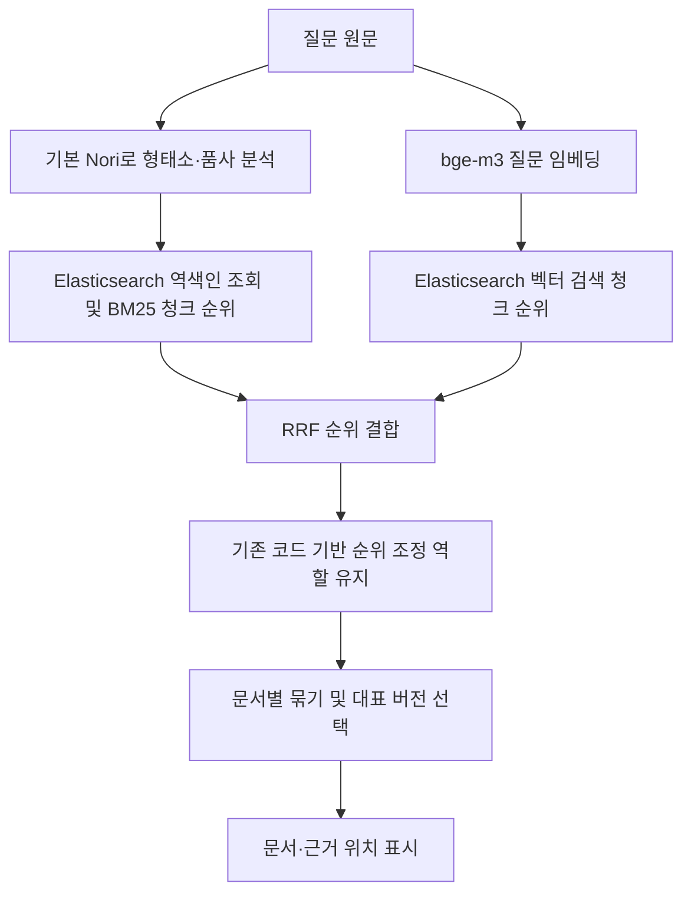

원본 자료가 존재

- 원본 자료를 어떻게 청킹할 것인가 => 기준을 어떻게 정할거지?
- 청킹을 정한 기준으로 한다고 했을 때 어떤 방식으로 나누는지? => 기술적인 방법
- 청킹된 자료를 임베딩하면 어떤 추가적 정보도 포함해야하나?
- 자료들을 청킹할 때 코드의 규칙을 기준으로 청킹한다고 했는데 LLM이 아니라 코드로 청킹한 이유는? 코드로 청킹했다면 코드의 규칙 또한 어떤 규칙들이 존재했는지?
- 청크들을 임베딩 할때에는 어떤 모델을 사용할 것이며 단순 임베딩만 하는 것이 아니라 임베딩과 함께 어떤 내용을 추가하여 저장소에 저장할 것인가?(저장 양식)
- 질문 임베딩을 통해 기존 저장소의 내용들과 비교해야 하는데 임베딩은 그럼 어떤 방식으로 진행하는지?(모델을 사용한다면 어떤 모델로 선정하였고 해당 모델을 선정한 이유는?)
- 키워드 검색과 벡터 검색을 통해 순위를 내는 경우 이 순위들은 청크 순위인데 2

보통 어떤 모델을 사용하고 예비 데이터셋으로 어느 정도 준비해놓고 과정 속에서 몇 개의 후보를 ranking 하고 reranking도 있다면 어느정도의 개수로 하는지

+ GraphRAG 에는 LightRAG방식과 Microsoft GraphRAG 방식이 존재함. 
+ RAGFlow 에서는 LLM으로 청크에 단서를 붙인다고 하는데 이를 위한 LLM 리소스는 어떻게 하지?

모델을 다운로드 받을 때는 한번에 다 받는게 아니라 여러 개의 가중치들을 

safetensors 확장자로 보통 배포를 많이함. 구조에 따라 가중치별로 나눠서 배포하거나 하나로 합춰서 배포함.
GGUF 확장자를 사용하기 시작. Lamma cpp 도구가 사용하는 파일의 확장자가 gguf 임. 즉, c/c++ 에 맞춤형 확장자. but 단일 파일로 이루어져있음. C/c++ 은 저레벨 코드이기에 어떤 환경에서든 실행할 수 있도록 하는 목표가 존재했음.  단일 gguf 파일만 다운로드 받으면 끝이라는 철학. 단일 파일로 어떤 환경에서든 실행할 수 있도록. 
Ollama 는 기존의 Lamma 위에서 명령을 처리하게 하되 별도의 공부 없이 간단한 명령어로 사용할 수 있도록

옛날에 Ollama를 많이 쓰던 이유는?
그당시 => LLM이 오픈소스로 활발하지 않았을때 (GPT3,4)
오픈소스 LLM 모델에 대한 접근성이 떨어졌음. 그러니까 이때는 한줄만으로 실행이 된다는 말이 획기적으로 느껴졌음. 하지만 지금은 Lamma cpp의 단점이 꽤 많음... 즉, 추론 속도가 느림...모든 하드웨어를 고려하다 보니 특정 하드웨어에 특화되어 빠르게 제공되지 않음. 그리고 동시에 실행이 불간으함. 한번에 한 번의 호출만 가능. 

Lamma  => 어떻게 하면 하드웨어 특화된 속도를 낼 수 있을까? 어떻게 하면 병렬처리가 가능하게 할까?

vLLM  => 호출이 많을 때 다른 호출을 막지 않음. 

잿슨 =>  통합메모리 왜 씀?? HBM 비싸서..효율적이라서...고메모리 사용하는 프로그램들은 gpu 램이랑 기존 램이 따로 붙어있음. 목적 자체를 생각해보자. 

chatgpt 서버를 구축했다 ? => 내가 만든 프로그램에서 지금 설치한 모델을 호출할  수 있다. 

인덱싱 테스트에서 예상 질문에 대해 나와야하는 정답 문서가 존재. 정확히는 예상 질문이 아니라 검색어이긴해. 아무튼 그 검색어에 대한 정답 문서가 잘 나오는지? 검색 결과 상위 5개 안에 이 둘 중 하나라도 있으면 성공!
왜? 앞단계에서 뭐라도 잘못되어있으면 결과가 이상하게 나올 수밖에 없음

LLM을 사용하는 이유는?  문서보강에서 쓰이고 문서 내에 다양한 날짜가 들어가있거나 금액이 들어가있을 경우 이들을 구분하기 위;해서는 판단이 필요. 즉, 기존 문서의 내용을 텍스트화하는 파싱된 내용에 대해 LLM을 1번씩 돌려 JSON 형태로 반환. 이후 청킹함. 청킹된 문서에는 해당 청크가 어디 문서에서 왔고 해당 문서의 정보는 어떤지 등이 들어가면 나중에 검색하는 과정에서 찾기 쉬운데 이를 위해 미리 LLM으로 이 정보들을 뽑아내는거임.단순 경로,텍스트 내용 뿐 아니라 텍스트 내용이더라도 구분하기 힘든 것을 판단할 수 있도록. doc-id, 거래처, 문서종류, 문서일자, 문서상태(초안,검토,완성), 최신본인지, 동일 폴더에 속해있는지 등을 청크에 쓸 수 있도록 미리 LLM을 통해 뽑아내놓는거임 JSON 형태로. 

sharepoint => 확장자,작성자,생성일,수정일,폴더경로,파일이름

지훈님의 모델 선정 기준
한국어 잘해야한다, 비전 모델의 경우에는 비전 인식 능력 
초당 토큰, 정확도, 동시사용자, 

qwen 3.6 35B A3B

MOE 모델
효율이 좋다, Gumbel Softmax, load balaancer
MOE를 쓰면 시간이 줄어들기도 함. 그럼 왜 Spark에서는 MOE를 써야할까?
A2B. => 질문을 던졌을 때 한 Expert 부분의 크기가 3B이다. 

## <Q리스트>
그럼 다음 단계로 넘어가자. 예비 데이터셋을 기준으로 비전 LLM의 출력 형식과 평가 기준을 정해줘. 글자뿐 아니라 표의 관계, 구성도의 흐름, 사진의 의미적 맥락도 평가할 수 있게 해줘.

자 그럼 현재 리랭킹을 제외하고 진행한 검색구현 맞지? 근데 최종 답변이 나오기 전까지 내가 하고 싶은건 키워드 검색과 의미 기반 검색에서 나온 순위들을 보고 이 순위들이 하나의 순위로 결합되는 과정을 실제로 보고싶어. 즉, 각 검색의 순위에서 어떤 문서들이 나왔고 결합된 순위는 어떻게 결론이 났는지 확인하고 싶어.이 과정을 너가 답변을 낼때 차례차례로 하나씩 글이 생성되는 것처럼 그 과정을 상세히 볼 수 있도록 구현할 수 있어?

각 문서형식마다 청킹을 하는 단위가 다름. 예를 들어 PPT는 한 슬라이드마다 나누고 슬라이드 내에 표가 나올 경우 표도 따로 청크로 뺸다. 

## 전체 단계

#### <인덱싱>
문서 110개
- 만들어놓은 문서는 DOCX,PPTX,XLSX,PDF,TXT,LOG 형식이고 문서의 유형은 계약서,제안서,견적서,네트워크 구성도,서버 구성도, 실행 로그, 기타 로 나누었다.

|문서종류|DOCX|PPTX|XLSX|PDF|TXT|LOG|합계|
|---|---|---|---|---|---|---|---|
|계약서|13|0|0|13|0|0|26|
|제안서|0|8|0|5|0|0|13|
|견적서|0|0|19|1|0|0|20|
|네트워크 구성도|0|9|0|1|0|0|10|
|서버 구성도|0|4|4|0|0|0|8|
|실행 로그|0|0|0|0|4|25|29|
|기타|0|0|0|0|4|0|4|
|**합계**|**13**|**21**|**23**|**20**|**8**|**25**|**110**|

이 내부에는 오로지 글로 된 것도 존재. 글과 이미지가 같이 있는 것도 존재하고 글과 표,이미지 등 글,표.이미지, 그림, 이 복합적으로 섞여있는 문서가 존재함. 이들을 어떻게 파싱하여 청킹하고 임베딩할지를 고민해야함. 

현재 문서 점수는 기본적으로 그 문서에서 가장 높은 점수를 받은 청크를 기준으로 한다. 청크가 많다는 이유만으로 점수를 계속 합산하지 않는다. (점수를 계속 합산할 경우에 발생하는 문제는?)

## 인덱싱 단계

자료를 파싱하는 단계에서 문서보강을 하지 않고 JSON 의 형태로 만들어 청킹. 청킹의 경우에도 기존의 규칙대로 하되 과도하게 많은 단위로 찢어지는 것과 적은 단위로 찢어지는 것을 막는다. 그래서 여기서 해야할 것! 

1. 청킹을 하는 규칙을 정하고 대략 400~ 600토큰 단위로 하되 만약 해당 토큰으로 끊었을때 문서의 의미가 너무 잘린다면 이를 보완하기 위한 규칙을 추가하고 의미를 최대한 보존한다.
2. 질문 분석에 LLM을 사용할지는 아직 미정이다. 사용한다면 질문에 명시된 조건·정렬·포함/제외 관계를 해석하고 원문 근거를 함께 반환하는 역할로 제한한다. 검색어 생성·동의어 확장·문서 순위 재판정은 맡기지 않는다. 아래의 2026-10-27 검색 설계 결정 참고.
3. 사용자 사전과 검색어 확장 규칙은 만들거나 사용하지 않는 방향으로 변경한다. 문서와 질문을 기본 Nori로 형태소·품사 분석하고, 질문 자체에서 얻은 검색 단위로 Elasticsearch의 BM25가 청크 순위를 계산한다. BM25에 별도 용어 사전이나 LLM의 사전 생성이 필요한 것은 아니다. Nori는 단어 분리·품사 분석을 맡으며, 주어·목적어 관계나 검색 의도를 모두 해석하는 구문 분석기는 아니다. Nori에 내장된 기본 사전은 사용하지만 프로젝트별 용어 목록·별칭 목록·동의어 확장 규칙은 추가하지 않는다.
4. 키워드 순위,의미기반검색 순위, 순위 결합, 재정렬 등에서 모두 상위 50개,30개 등의 기준이 있는데 결국 마지막 정확도를 높이기 위해서는 50개,30개가 아니라 앞쪽 프로세스서부터 상위 10등, 5등과 같이 더 범위를 좁혀야한다.
5. 마지막 답변 과정에서는 나온 최종 5개에 대해서 실제 근거가 나왔던 근거인지 실제 없는데 지어낸 근거는 아닌지 재차 검토하는 과정 필요. 정답이 되면 안되는 청크를 주고 이것을 정답으로 선정하는지를 테스트해보자!

## 검색 구조 — 2026-10-27 설계 변경 결정

이번에 확정한 방향은 **사용자 사전·검색어 확장 규칙 없이, 질문 원문을 Nori로 분석하고 BM25로 키워드 검색 순위를 만드는 것**이다. N만 개 문서에 등장하는 거래처·시스템·전문 용어를 별도 목록으로 미리 등록하고 유지하는 방식을 전제로 하지 않는다.

**반영 상태:** 이 절은 새 설계 결정이다. 현재까지 확인된 검색 코드와 Elasticsearch v003 색인은 아직 이 방식으로 전환하지 않았다. 기존 v003은 사용자 사전 48개 항목을 적용한 195문서·3,754청크 색인이며, 기존 검색 코드는 검색어 확장 규칙도 사용한다. 기존 평가 성적은 사전 없는 새 구조의 성적으로 해석하지 않는다.

### 청킹된 JSON이 색인되는 방식

청크 JSON 한 건은 Elasticsearch 청크 색인에서 문서 한 건으로 저장한다. JSON 원문을 보존하면서, 검색에 필요한 필드별 내부 색인을 함께 만든다.

| 청크 JSON 필드 | 색인 단계에서 하는 일 | 검색할 때의 용도 |
|---|---|---|
| `body`, `context`, `table_header`, `file_name` | 기본 Nori로 분석하고, 단어가 등장하는 청크·빈도·위치 등을 역색인에 기록 | 질문에서 분석한 단어와 대조해 BM25 점수 계산 |
| `metadata` | 날짜·문서 종류 등 필드에 맞는 형식으로 저장 | 확인된 조건의 필터와 날짜 정렬 |
| `embedding` | 본문·문맥·표 머리글을 연결한 입력을 bge-m3로 변환한 1,024차원 벡터 저장 | 질문 벡터와의 의미 유사도 검색 |
| `doc_id`, `chunk_id`, `source_refs` | 원본 문서·청크·페이지/슬라이드/셀/줄 연결 정보 보존 | 청크를 문서로 묶고 실제 근거 위치 표시 |

역색인은 개념적으로 `단어 → 그 단어가 들어 있는 청크들`이라는 연결 구조다. JSON의 본문을 단어 목록으로 덮어쓰지 않는다. 실제 내부 색인은 Elasticsearch/Lucene가 관리하며, 사람이 작성한 사용자 사전과는 별개다. BM25 점수는 색인 시 고정해 저장하는 값이 아니라 질문이 들어왔을 때 계산하는 값이다.

### 질문에서 키워드 순위를 만드는 방식

Elasticsearch의 검색 대상 필드에 기본 Nori 분석기를 지정하면 질문 원문도 검색 시 분석된다. 별도 프로그램이 미리 준비한 용어 목록에서 검색어를 고르지 않는다. 한영 변환, 동의어 추가, 특정 질문 표현에 대응하는 검색어 추가도 하지 않는다. 사전이나 고정 표현표에서 만든 개념 태그로 검색 후보를 추가하거나 점수를 올리는 경로도 새 구조에서는 제외한다.

예를 들어 “올해 돌린 백업 로그”의 키워드 분기는 질문에 실제로 있는 표현을 분석해 검색한다. `backup`, 특정 작업명 등 질문에 없는 표현을 자동 추가하지 않는다. “올해”를 날짜 범위로 해석해 필터를 적용하는 것은 형태소 분석과 구별되는 질문 조건 처리다. 질문과 문서의 표현이 달라 키워드 분기에서 놓치는 자료는 기존 의미 검색 분기에서 찾을 수 있는지 평가한다.

Nori의 기본 내장 사전은 분석기의 일부다. 이번 결정은 우리가 별도로 작성·생성·관리하는 사용자 사전과 검색어 확장 규칙을 사용하지 않는다는 뜻이다. 명사만 무조건 남기는 방식은 동작·부정 표현을 잃을 수 있으므로, 일반적인 품사 필터 설정은 실제 질문의 분석 결과를 확인해 정한다.

### LLM 질문 분석 — 도입 방식 미정

LLM 질문 분석을 사용할지는 아직 확정하지 않았다. 제안된 비교 방법은 먼저 LLM 없이 새 키워드 검색의 기준 성능을 측정하고, 복잡한 요청에서만 LLM 조건 해석을 추가했을 때 효과와 지연을 비교하는 것이다.

| 사용할 경우의 역할 | 예시 |
|---|---|
| 날짜 역할·정렬 해석 | “가장 최근에 작성된”은 작성일 내림차순, “마지막 수정”은 파일 수정일 기준으로 구분 |
| 문서 종류와 포함 내용 구분 | “구성도가 포함된 문서”는 제안서 안의 구성도도 대상으로 해석 |
| 포함·제외와 복합 조건 해석 | 질문에 명시된 제외 대상과 포함 대상을 구분 |
| 모호성 확인 | 날짜나 대상이 여러 방식으로 읽히면 임의로 확정하지 않고 확인 필요 상태 반환 |

LLM을 쓰더라도 BM25 검색어는 질문 원문을 Nori로 분석해 얻는다. LLM은 질문에 없는 검색어·거래처·시스템을 생성하거나 동의어를 덧붙이지 않는다. 조건·정렬 결과는 질문 속 근거 문구와 함께 반환하고, 프로그램이 허용 필드·자료형·근거 존재·모순 여부를 확인한 뒤 적용한다. 거래처명 등 전체 자료의 용어 목록을 프롬프트에 제공하는 방식을 전제로 하지 않는다.

명확한 상대 날짜처럼 일반 계산으로 처리할 수 있는 조건은 LLM 없이 처리할 수 있다. 명시된 날짜 조건을 시간 초과나 검색 결과 없음 때문에 자동으로 없애지 않는다. 처리하지 못한 조건은 사용자에게 확인이 필요한 상태로 표시한다. 문서 원문을 읽고 순위를 바꾸는 Qwen 원문 대조는 이번 질문 분석 역할에 포함하지 않는다.

### 구현과 평가 시 확인할 사항

- 기본 Nori를 적용한 새 텍스트 색인을 만들고, 기존 청크 JSON과 입력이 동일한 bge-m3 벡터는 재사용한다. 이 설계 변경 자체로 파싱·비전 처리·문서 보강을 다시 호출하지 않는다.
- 질문 분석, BM25 후보 생성, 코드 기반 순위 조정에서 사용자 사전·별칭 목록·검색어 확장·사전 기반 개념 태그가 남아 작동하지 않는지 확인한다. 코드 기반 순위 조정의 역할과 사전에 의존하는 개별 계산은 구분한다.
- 기존 150개 질문과 표현 변형 16개로 키워드 후보 포함 여부, 최종 상위 5개 결과, 기간 밖 문서 혼입과 처리 시간을 비교한다. 새 구조의 성능은 아직 측정하지 않았다.

