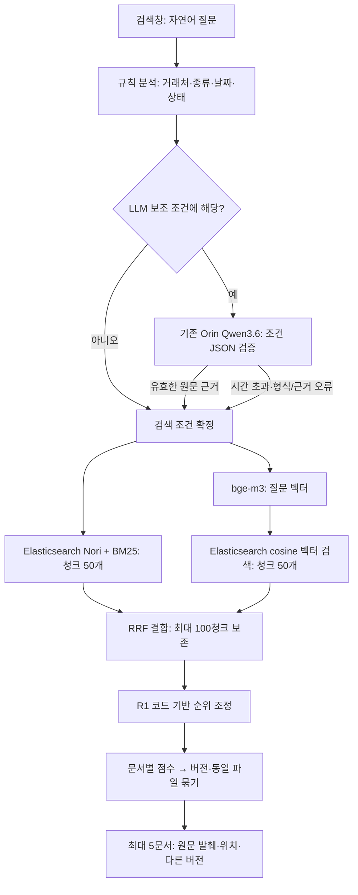

# 검색 설계와 첫 구현

2026-10-20. 사용자 요청으로 검색 구현을 시작했다. 기준은 첨부한 `RAG_전체구조와_실제입출력_통합설명.md`와 그 문서가 참조하는 `RAG_검색설계_for_GPT(20261020).md` v2.17이다. 원본 첨부 문서는 수정하지 않았다.

**현재 목표는 110개 예비 문서를 실제로 검색하는 API와 확인 화면이다.** 실제 SharePoint 수집·변경분 동기화, 직원별 권한 확인, Teams 배포는 이 구현에 포함되지 않는다. 기존 발췌 요약 17개와 의미 보강 청크 17개는 사용자의 후속 결정에 따라 유지한다. 질문에 대한 생성형 답변이나 결과별 새 요약은 만들지 않는다.

## 사용하는 기술과 역할

| 부분 | 기술 | 실제 역할 |
|---|---|---|
| 질의 분석 | Python 규칙 + 기존 Qwen3.6-35B-A3B-AWQ-4bit/vLLM | 명시된 거래처·문서종류·기간 등 추출. 모델이 제안한 조건은 허용 값과 질문 속 근거를 검증한다. |
| 키워드 검색 | Elasticsearch 8.19.23, Nori mixed, BM25 | 기존 거래처·시스템 사전을 Nori 사용자 사전에 추가하고, 파일명·머리말·본문을 검색한다. |
| 의미 검색 | 기존 bge-m3, Transformers/PyTorch | 원문 질문에 접두어를 붙이지 않고 1,024차원 벡터를 만든다. 색인 때와 같은 모델 해시·CLS·L2 정규화·FP16 계산을 사용한다. |
| 벡터 저장/검색 | Elasticsearch dense_vector, cosine, flat | 기존 1,089개 벡터를 재사용한다. FAISS를 실행하지 않는다. 현재 flat이므로 HNSW 근사 검색으로 설명하지 않는다. |
| 결합·정렬 | Python RRF, 선택적 R1 | BM25 점수와 cosine을 직접 더하지 않고 순위로 합친다. R1은 별도 모델 없는 코드 기반 실험이다. |
| API·확인 화면 | FastAPI, Uvicorn, HTML/JavaScript | 검색창 하나와 문서 카드를 제공한다. 검색·클릭 기록을 저장하지 않는다. |
| 실행 환경 | Orin의 별도 Docker 컨테이너 `rag-search` | bge-m3를 한 번 로딩해 계속 재사용한다. 기존 Qwen·Elasticsearch 컨테이너는 유지한다. |

## 구현 순서와 시작값

1. 원본을 바꾸지 않고 검색용 메타데이터를 준비했다. 파일명·폴더·추출된 버전과 수정 시각으로 문서군을 만들고, 파일 해시로 동일 사본을 연결한다. 이전 색인을 보존한 별도 `rag-search-documents-v001`, `rag-search-chunks-v001`에 저장한다.
2. 질문 분석과 두 검색 분기를 연결했다. 같은 강제 조건을 BM25와 벡터 검색에 적용한다.
3. RRF, 문서별 묶기, 원문 발췌, 0건 완화, 검색 API와 화면을 연결했다.
4. 정해진 61개 질문으로 A/B 필터와 R0/R1을 비교한다. 전체 통과 여부는 [평가 보고서](../outputs/search-service-001/REPORT.md)에 따로 기록한다.

| 설정 | 현재 구현 |
|---|---|
| BM25 | 파일명 2배, 문맥 머리말·표 머리글 1.5배, 본문 1배; 최소 단어 일치 50% |
| 기존 한영 사전 | 이전에 검수한 operations vocabulary를 그대로 사용. 새로운 질문별·문서 ID별 가중치 없음 |
| 후보 | BM25 50청크, 벡터 50청크, `num_candidates=200` |
| RRF | 동일 비중, `1/(60+순위)`, 중복 제거 후 최대 100청크 모두 전달 |
| 문서 점수 | 전체 후보 중 최고 청크 + 결합 상위 30개 안의 추가 최대 3청크 점수의 각 10% |
| R1 | 정규화 RRF 45%, 제목/본문 단어 일치 20%, cosine 20%, 구문 일치 5%, 번호 일치 5%, 조건 선호 5% |
| A 조건 | 거래처·문서종류·명시적 날짜·명시적 상태는 강제, 최신본은 선호. 대상 시스템·통화·VAT·실행결과는 추가 선호 |
| B 조건 | 기본은 거래처만 강제, 나머지는 선호. 단, 명시적 포함 내용과 그 바깥 문서종류는 필수 조건 |
| 후보의 선호 반영 | BM25 조회에서 명시된 선호 조건마다 constant score 1점, 최신본 1점 가산. 벡터 분기는 동일 강제 필터를 적용한 원래 cosine 순위 유지 |
| R0의 선호 반영 | 조건 선호율에 따라 RRF 점수를 최대 10% 가산 |
| LLM | temperature 0, thinking off, JSON schema, 출력 최대 300토큰 |
| LLM 대기 예산 | 첫 실행 3초. 전체 3초 목표를 위해 두 번째 실행부터 2.5초로 제한하고 나머지를 검색·카드 생성에 남김. 형식 오류는 남은 예산 안에서 최대 1회 재시도 |
| 상대 날짜 | 화면은 서울 시간 오늘, 고정 평가는 2026-10-14 |

A/B는 Hit@5가 2문항 이상 차이 나면 높은 쪽, 그보다 작으면 정답을 제외한 강제 필터가 적은 쪽, 다시 같으면 B를 고른다. R1은 Hit@5가 2문항 이상 또는 MRR이 0.05 이상 개선되고, 유형별 하락이 3%p 이내이며, 응답 시간 기준을 유지할 때만 채택한다. 설계 문서가 `Recall@5`라고 부른 **정답 문서가 하나라도 보인 질문의 비율**은 혼동을 피하려고 보고서에서 `Hit@5`로 표시한다. 모든 정답 문서의 개별 재현율은 별도로 계산한다.

R1은 두 분기 중 어디에서 나온 청크인지와 관계없이, 합친 최대 100개 청크의 저장 벡터와 현재 질문 벡터로 실제 cosine을 다시 계산한다. 벡터 상위 50개에 없다는 이유로 cosine을 0으로 취급하지 않는다. 초기 실행에서 빠져 있던 두 연결(후보 단계의 선호 가산점, BM25 전용 후보의 cosine)을 보완한 기록도 결과 디렉터리에 보존한다.

## 입출력 규칙

`POST /search`의 기본 입력은 `{"query":"청람정밀 MES 고도화 계약서"}`다. 확인용 API에는 고정 평가 날짜, A/B, R0/R1을 지정하는 선택 입력도 있다. 화면에는 이런 선택 필터를 두지 않는다.

출력은 `status`, `query_plan`, `results`, `relaxed_conditions`, `timings`, `diagnostics`다. 날짜 정렬에는 `date_coverage`와 `undated_results`, 포함 내용 검색에는 카드의 `content_evidence`도 제공한다. 각 문서에는 식별자, 실제 파일명, 추출 메타데이터, 원문 발췌, block_id와 문자 범위, 페이지/슬라이드/셀/줄 위치, 다른 버전, 최신본 연결이 들어간다. 실제 원본 URL이 없으면 `url:null`로 반환한다. 예비 데이터에는 SharePoint 링크가 없어 원본 열기 버튼을 만들지 않는다.

발췌는 저장된 공통 블록에서 실제 문자열을 잘라 낸다. 파생 머리말이나 LLM이 작성한 시각 구조 설명을 원문 인용으로 바꾸어 보여주지 않는다. 키워드 일치가 있으면 최대 3개·각 최대 100자, 의미 검색만 일치하면 직접 발췌 1개를 표시한다. 표시할 직접 인용이 없으면 그 상태를 명시한다.

대표 문서는 질문이 지정한 버전 → 지정한 상태 → 번호 근거를 가진 버전 → 요청한 최초 숫자 버전 → 요청한 날짜 순서 → 검색 후보 중 최신본 순으로 선택한다. 최신본이 검색 후보에 없으면 일치한 이전 버전을 대표로 두고 최신본 정보를 연결한다. 다른 버전의 근거를 최신본에 붙이지 않는다. 같은 해시의 사본은 깨끗한 파일명을 우선한다. 업로드 시각이 없으므로 그다음 동률은 문서 ID로 결정한다. 이를 실제 최초 업로드 순서라고 부르지 않는다.

두 검색 분기가 모두 0건일 때만 날짜 → 문서종류 → 상태 순으로 조건을 완화하고 화면에 표시한다. 거래처, 명시적 포함 내용, 포함 요청에서 지정한 바깥 문서종류는 풀지 않는다. 검색 서버 오류는 0건으로 취급하지 않고 서비스 오류로 반환한다. 부정 조건, 여러 거래처, 해석하지 못한 기간은 구체화가 필요하다고 반환한다. 단, 연도와 계절을 함께 말하면 확실한 연도만 선호 조건으로 사용하고 계절의 정확한 월은 확정하지 않았음을 표시한다.

### 작성일 정렬과 구성도 포함 조건 — search-1.1.0

‘가장 최근에 작성된’ 또는 ‘작성일 최신순’은 `written_date` 내림차순이다. 수정일은 `file_modified_at`, 표지 날짜는 `cover_date`를 사용한다. 다른 날짜로 대체하지 않는다. 날짜 정렬은 두 분기의 상위 후보 수에 제한받지 않고, 동일 조건에 맞는 전체 청크를 Elasticsearch `search_after`로 2,000개씩 조회한 뒤 문서·버전을 묶고 상위 5개를 선택한다. 현재 색인은 고정 상태를 전제로 한다. 운영 중 변경되는 색인에는 PIT 등 일관된 조회 시점 보장이 별도로 필요하다.

정렬 날짜가 없거나 추출 확정 상태가 아닌 문서는 최신순 순위에서 제외하고 `undated_results`에 별도로 최대 5문서군을 표시한다. `date_coverage`의 문서 수는 버전 묶기 전 파일 수다. ‘최신’은 **작성일이 확인된 일치 문서 중 최신**이며 날짜 없는 자료보다 실제로 나중에 작성되었다고 단정하지 않는다.

‘네트워크 구성도가 포함된 문서’는 바깥 문서종류를 네트워크 구성도로 제한하지 않는다. 기존 공통 블록에서 사실 색인용으로 채택된 구성도 연결선과 연결 노드의 네트워크 장비·망 표현을 확인해 포함 조건을 만든다. 제목·본문에 단어만 등장하거나 보류된 원시 비전 응답만 있는 경우는 근거로 삼지 않는다. 사용자/외부망→보안·네트워크→서버 구성도도 해당하므로 제안서를 포함한다. 단순 서버·로드밸런서 구성만으로는 자동 확정하지 않는 보수적인 규칙이다.

이 조건의 문서 ID 집합은 BM25·벡터·전체 날짜 조회에 동일하게 적용하며 자동 완화하지 않는다. ‘구성도가 포함된 제안서’처럼 바깥 종류도 명시하면 그 종류 역시 필수로 적용한다. 기존 평가 정답이나 특정 문서 ID를 규칙에 넣지 않는다. 시작 시 기존 블록으로 집합을 계산하므로 원본 JSON·임베딩·Elasticsearch 색인을 다시 생성할 필요가 없다. 색인 자료가 바뀌면 블록과 검색 데이터를 함께 갱신해야 한다.

현재 23파일(독립 구성도 10, 제안서 13)의 근거가 확인됐다. 제안서 13개는 표지 날짜만 있고 명시적 작성일이 없어 별도 목록으로 분리된다. 카드에 포함 근거의 페이지/슬라이드와 장비명을 표시한다. 이는 기존 채택 블록에 대한 확인이며 새로운 독립 이미지 검수 점수가 아니다. [수정·회귀 평가](../outputs/search-written-content-001/REPORT.md).

## 단계별 청크 순위 표시 — search-1.2.0

화면은 `POST /search/stream`을 사용한다. 한 번의 검색 실행에서 실제 단계 완료마다 NDJSON 이벤트를 전달한다. 키워드·의미 검색은 병렬로 실행하고 각 응답이 돌아오는 시점에 해당 순위를 표시한다. 인위적인 타이핑 지연이나 추측한 중간 순위를 만들지 않는다. 기존 `/search` 응답과 순위 기준은 유지한다.

- 키워드 검색: 실제 상위 최대 50청크. 의미 검색: 실제 상위 최대 50청크.
- 결합 순위: 중복 청크를 합친 전체 후보 순위. 각 청크의 두 분기 원래 순위도 표시한다. 분기 후보에 없으면 ‘후보 밖’으로 표시한다. 결합 계산식과 점수는 화면에 표시하지 않는다.
- R1 적용 순위: 결합 후보 전체(최대 100청크)를 조정한 결과와 결합 당시 순위를 표시한다. 별도 모델 리랭커를 새로 사용하지 않는다.
- 날짜순 요청: 결합 결과는 참고용임을 밝히고 전체 일치 자료에서 요청한 날짜로 정렬한 청크를 별도 표시한다. R1 결과가 최종 날짜 순위인 것처럼 표시하지 않는다.
- 최종 문서: 기존 문서·버전 묶기 결과이며 청크 순위와 구분한다.

각 행에는 순위, 출처 문서명, 문서 ID·청크 ID, 페이지/슬라이드/문단/셀 위치를 표시한다. 내용 일부(검색용 청크 본문 180자)는 펼쳐 볼 수 있으며 최종 카드의 직접 원문 인용과 구분한다. 각 목록은 처음 5개를 표시하고 나머지 전체 순위는 펼칠 수 있다. 문서를 실시간으로 여는 기능은 추가하지 않았다.

연결이 끊기거나 검색 오류가 발생하면 중간 결과라고 표시하고 완료로 처리하지 않는다. 조건이 모호하여 검색하지 않은 경우 순위를 꾸며 보여주지 않는다. 요청별 임시 큐만 사용하고 운영 검색·단계 로그는 저장하지 않는다. 고정 개발 평가의 단계 응답만 별도 평가 결과로 보존했다. [검증 보고서](../outputs/search-rank-trace-001/REPORT.md).

## 운영 경계와 남은 검증

- 사용자 화면: `http://127.0.0.1:18020/`. VPN·인증된 SSH 터널·Orin이 연결되어 있어야 한다. Orin API는 `127.0.0.1:8020`에만 바인딩한다.
- 모델은 새로 다운로드하지 않았다. 외부 유료 API는 호출하지 않았다. Qwen의 기존 문맥·메모리 설정도 바꾸지 않았다.
- 기존 색인·17개 요약·벡터·정답·저장 응답은 덮어쓰지 않았다. 검색용 새 색인은 별도다.
- 검색 API는 질문을 저장하지 않고 HTTP 접근 로그도 끈다. 정해진 개발 평가 질문의 응답만 평가 디렉터리에 저장한다.
- 현재는 개발용 화면이다. 실제 문서 권한, 로그인, SharePoint URL·증분 수집, Teams 연결을 검증한 상태가 아니다.
- 정확 번호 검색 결과를 상단에 고정하는 별도 **2a 분기는 보류**한다. R1의 후보 내 번호 점수와 2a 분기를 혼동하지 않는다.
- 새 리랭커 모델 R2/R3, 운영 질문 수집, OpenRouter 유료 재평가, Spark 전환은 실행하지 않았다.
- 독립 평가가 아니다. 원본 정답의 필터와 현재 메타데이터 의미가 어긋나는 항목, 질문별 대표 버전 정답의 별도 검수는 평가 보고서에 남긴다. 자동 점수만으로 전체 검색을 통과했다고 선언하지 않는다.

관련 구현: [질의 분석](../deploy/search/query.py), [검색·결합·근거](../deploy/search/engine.py), [API](../deploy/search/service.py), [평가 실행기](../deploy/search/evaluate_remote.py), [계약 테스트](../deploy/search/test_search.py).

## 간접 표현·날짜·최초 버전 보완 — search-1.3.1

원본 검색 설계 S-06은 운영 기준일=KST 오늘, 평가 기준일=2026-10-14를 결정했다. S-07의 A/B 비교 후 B(거래처만 강제)가 채택됐다. S-05a의 “여름쯤 등 미해석 날짜에 LLM 호출”은 미정·튜닝 항목이며 계절의 월 범위는 결정하지 않았다. 종전 구현은 미해석 날짜에 검색 자체를 중단했고, LLM 스키마에 날짜 필드도 없어 성공하더라도 이를 풀 수 없었다.

현재 정책은 다음과 같다.

| 표현 | 처리 | 적용 필드 |
|---|---|---|
| 올해 / 작년·지난해 / 재작년 | 기준 연도 / 전년 / 전전년의 달력 범위 | 별도 역할 없으면 document_date |
| 2025년 6월 / 2025년 6월 21일 | 해당 월 또는 일의 정확한 범위, 불가능한 날짜는 확인 요청 | 질문의 날짜 역할 |
| 작년 여름쯤 | 2025년만 우선, 여름의 월 범위는 확정하지 않음 | document_date(별도 역할 없을 때) |
| 재작년 겨울 무렵 | 2024년만 우선, 겨울을 전후 연도나 특정 월로 단정하지 않음 | document_date(별도 역할 없을 때) |
| 여름쯤 / 지난 분기 등 현재 미지원 표현 | 기준 연도·범위 확인 요청 | 임의 필터 없음 |
| 작성일 / 작성된 | 명시 작성일 | written_date |
| 표지 날짜 | 표지에 적힌 날짜 | cover_date |
| 수정일 | 수집한 파일 최종 수정 시각(KST 경계 사용) | file_modified_at |
| 로그의 날짜 | 실행 시작일 | log_start |

B에서는 날짜에 맞지 않는 문서도 나올 수 있다. 날짜 선호와 “작성일 최신순” 같은 명시적 정렬은 다르다. 정렬은 전체 일치 자료를 해당 필드로 정렬하며 미확인 날짜를 다른 날짜로 대신하지 않는다. 제출일은 원문 근거 없이 만들지 않는다. 계약기간과 문서일자의 구분은 별도 남은 작업이다.

“바코드 단말기”→PDA/바코드, “와이파이”→무선/WiFi, “운송 시스템”→TMS/운송관리, “서버 옮긴·이전·이관”→migration/cutover/이전/이관은 검색어 확장으로만 사용한다. 인식한 각 개념은 모두 만족해야 하며 개념 내부 대체어는 하나 이상 일치하면 된다. 이를 거래처 추정이나 새 강제 필터로 사용하지 않는다. 기존 단어 검색과 원문 질문의 벡터 검색도 유지한다.

결합 뒤 상위 30개를 먼저 버리던 제한을 없애고, 이미 받은 BM25 50개와 벡터 50개의 합집합(최대 100청크)을 R1에 전달한다. 추가 문서 임베딩·모델 리랭킹은 없다. 화면과 진단 JSON에 실제 전달 수를 반영한다. `rrf_top30`은 종전 비교용이며 현재 전달 범위는 `rerank_candidates`다.

“첫 견적”, “처음 뽑은 가격표” 등은 검색된 같은 문서군의 숫자 버전 중 가장 작은 값을 대표로 고른다. v1을 무조건 강제하지 않으며 v2와 v10은 숫자로 비교한다. 찾지 못한 이전 버전까지 최초라고 보장하지 않는다.

후보 확장 검증에서 낮은 순위의 추가 청크까지 가산하자 긴 계약서가 단일 구성도를 밀어내는 회귀가 확인됐다. 후보 경쟁 범위(최대 100개)와 보조 가산점 범위(기존 결합 상위 30개)를 분리했다. 31위 이후도 문서의 최고 근거로 채택될 수 있지만 약한 추가 청크를 여러 개 가진 것만으로 점수를 더 받지는 않는다. 문서 종류나 정답 ID별 예외는 없다. 계절 단어는 단어 경계를 확인해 ‘새봄병원’의 ‘봄’을 날짜로 읽지 않는다.
