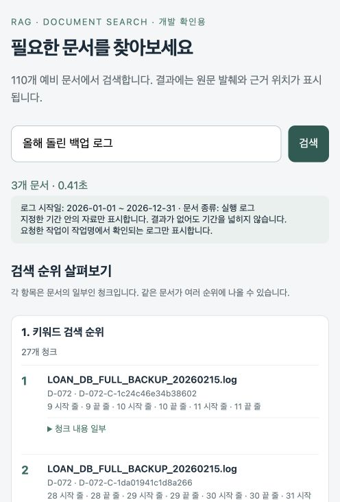
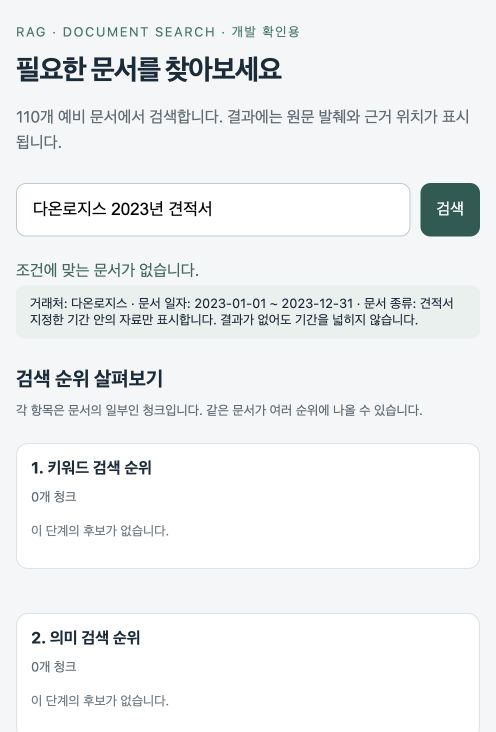

# 명시한 기간만 반환하도록 수정한 결과

Orin 검색 서비스 **search-1.5.0** 반영·화면 확인·99개 실제 API 평가 완료. 기존110문서·1,089청크와 벡터는 재사용했다.

## 요청한 동작

- 명시 기간은 BM25·벡터 후보 검색, 최종 문서 묶기, 다른 버전 표시까지 유지한다. 날짜를 확인할 수 없는 문서도 기간 질문에서 제외한다.
- 0건이어도 날짜를 자동으로 풀지 않는다. 함께 명시한 문서종류도 유지한다.
- 기간이 있는 작업 로그는 추출 작업명으로 작업을 확인한다. 단순히 본문에 백업이 언급된 유지관리 로그를 백업 로그로 넣지 않는다.
- 작성일·표지일·수정일·로그 시작일은 구분한다. 유지보수 적용연도는 명시 계약 시작일·종료일과 대조하며, 작성·체결연도와 혼동하지 않는다.

## Q-061: ‘올해 돌린 백업 로그’

올해=2026년(고정 평가 기준일2026-10-14). 아래 **3개만** 반환하며, 2025년 로그와 백업이 아닌 올해 로그는 나오지 않는다. 현재 순서는 관련도 순이며 최신순 정렬 요청은 아니다.

| 순위 | 문서 | 실행일 |
|---|---|---|
| 1 | D-109 · ERP_DB_FULL_BACKUP_20260308.log | 2026-03-08 |
| 2 | D-072 · LOAN_DB_FULL_BACKUP_20260215.log | 2026-02-15 |
| 3 | D-110 · ERP_DB_FULL_BACKUP_20260315.log | 2026-03-15 |

## 기존 정답표와 새 정책을 구분한 성적

| 범위 | 이전 | 이후: 원본 정답 기준 |
|---|---:|---:|
| 기존61 | 61/61 | 61/61 |
| 새 간접 표현30 | 30/30 | 30/30 |
| 조건 점검8 | 8/8 | 6/8 |
| 전체99 | 99/99 | **97/99 (97.98%)** |

기준은 상위5개에 필수 대표 문서가 모두 포함되는가이다. 반환 결과 전체가 정답 목록과 완전히 같다는 지표는 아니다. Q-061은 별도로 정확한3개 집합을 확인했다.

달라진 두 질문은 다음과 같다. 두 건을 제외한97개의 기존 성공은 유지됐다.

- **Q-068 ‘다온로지스 2023년 견적서’**: 기존 정답은 날짜 완화 후2025년 D-022·D-032를 기대한다. 이제2023년 자료가 없으므로 빈 결과가 맞다.
- **Q-069 ‘해솔유통 2024년 계약서’**: 기존 정답은 날짜 완화 후2025년 D-080을 기대한다. 이제2024년 계약서가 없으므로 빈 결과가 맞다.

따라서 원본 정답표의97/99를99/99로 바꾸지 않았다. 별도 새 정책 검사에서는 두 빈 결과가 모두 통과했다. ‘원래 성적 그대로100%’라고 해석하면 안 된다. 상위5개 문서와 순서까지 동일한 질문은89/99다.

## 기간 밖 문서 혼입 점검

99개 전체를 평가하고, 그중 연도·월 범위를 지정한11개 질문의 저장 결과를 원문 기반 메타데이터와 독립적으로 대조했다. 계절의 월 범위는 임의로 정하지 않았으며 명시 연도까지만 검사한다.

| 점검 대상 | 이전: 기간 내 / 밖 / 미확인 | 이후: 기간 내 / 밖 / 미확인 |
|---|---:|---:|
| 최종 문서 카드 | 21 / 27 / 7 | **29 / 0 / 0** |
| 카드 안 다른 버전 | 7 / 6 / 8 | **3 / 0 / 0** |
| 키워드 검색 후보 청크 | 221 / 155 / 51 | **263 / 0 / 0** |
| 의미 검색 후보 청크 | 204 / 289 / 57 | **356 / 0 / 0** |

질문 간 반복 노출도 각각 센 수이며 고유 문서 수가 아니다. 필수 날짜 필터11/11 유지, 날짜 완화0건, 빈 결과 기대2/2, Q-061정확히3문서 통과. 유지보수 계약은 문서 작성연도가 아니라 명시 적용기간을 기준으로 검사한다.

## 검증·시간·한계

- 동작 검사37개 통과. 실제99응답 모두 정상 수신, API 오류0건. Mac 화면에서3개 반환 및0건일 때 날짜 유지 안내 확인.
- 전체 평가85.35초. 평균 응답0.886→0.861초, p95 2.935→2.929초.
- 조건부 LLM19건은 시간 초과 후 규칙 처리,80건은 LLM 호출 없음. 이를 LLM 분석 성공으로 보지 않는다. 외부 유료 API 없음.
- 원본 질문·정답·이전 응답 보존. 정답 SHA256 `cfe07b187b4f76c8db5d64ce701ae02dfecc850c835c13032b46cf3c221788d0`.
- 배포 파일7개 로컬/Orin 해시 일치, 건강 상태ready=true, 원래/검색용 색인 각각110문서·1,089청크 유지.
- 개발 질문을 보고 개선한 결과다. 독립 운영 자료, 모든 표현의 날짜 해석, 일반적인 관련도 정밀도까지 검증한 것은 아니다.

## 근거 파일

- [99개별 전후 결과](ALL_RESULTS.md) · [원본 정답 기준 자동 비교](original-gold-comparison.md)
- [최종 점수](../search-gold-v2-run-005/summary.json) · [독립 날짜 대조](../search-gold-v2-run-005/date-policy-audit.json)
- [배포 확인](deployed-verification.json) · [새 날짜 정책 점검 명세](../../datasets/search-gold-v2/strict-date-policy-checks.json)
- [현재 검색 설계](../../docs/SEARCH_DESIGN.md)

