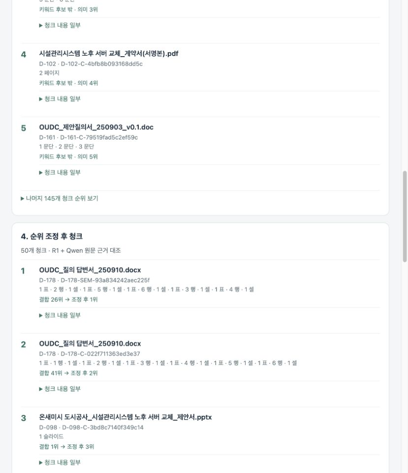

> **보존된 실험 결과:** 이 보고서의 search-1.8.4 Qwen 원문 대조는 현재 검색 화면에서 꺼져 있다. 현재 화면은 search-1.7.4 B+R1이며 OFF 재평가는 `../search-v31-source-review-off-001/REPORT.md`에 기록한다. 아래의 “적용 완료”는 당시 실험 배포 이력이다.

# 의미 표현 검색 개선 및 166질문 재평가

2026-10-26 · search-1.8.4 · 결과 기준 run-003. 사용자 화면18022에 적용 완료했으며 DEPLOYMENT.json에 실제 확인 기록을 남겼다.

기존 단어 규칙을 추가하지 않고, 키워드 후보가 없는 간접 질문에 기존 Orin Qwen3.6의 원문 대조를 연결했다. 인덱싱된195문서·3,754청크를 그대로 사용했다. 기존150개 필수 정답 상위5 성적은 **148/150 → 148/150**, 변형16개는 **10/16 → 16/16**이다. 기존 성공 회귀: 없음.

## 성능 비교

상위5 성공은 질문별 필수 대표 정답 전부 포함을 뜻한다. 변형 질문은 지정된 목표 문서의 포함 여부다. 정답1위는 별도 지표다.

| 평가 범위 | 이전 상위5 성공 | 개선 후 상위5 성공 | 이전 정답1위 | 개선 후 정답1위 |
|---|---:|---:|---:|---:|
| 기존150 | 148/150 | 148/150 | 100/150 | 107/150 |
| 그중 기존125 | 123/125 | 123/125 | 84/125 | 86/125 |
| v3.1 신규25 | 25/25 | 25/25 | 16/25 | 21/25 |
| 변형16 | 10/16 | 16/16 | 7/16 | 15/16 |
| 가까운 표현8 | 8/8 | 8/8 | 7/8 | 7/8 |
| 간접 표현8 | 2/8 | 8/8 | 0/8 | 8/8 |

## 실패했던6개

| 질문 | 실제 표현 | 이전 | 개선 후 | 정답 |
|---|---|---:|---:|---|
| Q-130-P05 | 공공기관이 낡은 서버의 하드를 버릴 때 어떻게 처리하라고 알려 준 자료를 찾아줘. | 상위5 밖 | 1위 | D-178 |
| Q-130-P07 | 옛 서버에 남아 있는 데이터를 담은 부품을 버려도 되는지 물어보고 공공기관에서 받은 답을 찾아줘. | 상위5 밖 | 1위 | D-178 |
| Q-131-P05 | 공공기관이 업체를 고를 때 싼 가격보다는 잘 수행할 능력을 더 중요하게 본다고 한 자료를 찾아줘. | 상위5 밖 | 1위 | D-175 |
| Q-131-P06 | 발주기관이 제안서를 비교하면서 비용보다 완성도를 더 높게 쳐 준다는 문서는? | 상위5 밖 | 1위 | D-175 |
| Q-131-P07 | 공공기관의 사업자 선정에서 얼마나 싸게 하느냐보다 얼마나 잘할 수 있느냐를 더 따지는 내용이 담긴 자료가 있어? | 상위5 밖 | 1위 | D-175 |
| Q-131-P08 | 공공기관이 입찰 업체의 제안을 채점할 때 금액보다는 수행 수준에 훨씬 많은 몫을 준다는 문서를 보여줘. | 상위5 밖 | 1위 | D-175 |

Q-130 계열은 `OUDC_질의 답변서_250910.docx`(D-178)의 표에서 “폐기 대상 디스크는 공사 직원 입회하에 물리 파쇄하고 파쇄 확인서를 제출할 것”을 근거로 선택했다. 질문만 적힌 질의서와 실제 지침이 적힌 답변서를 구분하는 판단이다.

Q-131 계열은 `온새미도시공사_시설관리시스템 노후서버 교체_제안요청서.pdf`(D-175) 1페이지의 “기술 평가 80 점, 가격 평가 20 점.”을 근거로 선택했다. “금액보다 수행 수준에 많은 몫”이라는 표현을 기술과 가격의 실제 배점 관계로 읽는 판단이다.

## 무엇이 달라졌나

검색 조건과 한영·동의어 규칙(query.py)은 이전 파일과 바이트가 같다. 질문 ID별 분기나 정답 ID 가산을 넣지 않았다. 검색 결과에서 모델이 고른 ID를 런타임에 우선하는 것이며 정답 목록을 모델에 보내는 방식이 아니다.

BM25 후보가 없고 기존 명시 조건·개념 확장으로 해결하지 않는 질문에 한해 의미 후보를 최대150청크로 넓힌다. 최대60문서의 제한된 본문을 Qwen이 읽고 가장 적합한 한 문서와 연속 인용문을 반환한다. 숫자가 직접 포함된 질문은 수치 조건 검증을 지원할 때까지 원문 대조로 순위를 바꾸지 않고 기존 결과를 유지한다. 전체 후보에 새 점수를 붙이는 전용 리랭커와는 다른 조건부 LLM 문서 선택 방식이다. 기존 RRF·R1 조정은 유지한다.

인용은 모델에 제공한 텍스트와 실제 공통 블록 양쪽에 있어야 한다. 모델 출력이 잘리거나 형식·근거가 틀리면 원래50청크 기반 결과를 유지한다. 같은 문서군의 다른 검색 후보에도 동일한 근거가 확인되면 기존 버전 선택 규칙을 따른다. 따라서 초안에 해당 문장이 있다는 이유만으로 근거가 같은 서명본을 밀어내지 않는다.

화면은 키워드·의미·결합된 청크 순위를 유지하고, 추가 원문 대조가 적용된 경우 그 상태와 근거를 표시한다. 최종 답변을 생성하는 단계는 추가하지 않았다.

## 시간과 모델 사용

시간은 요청 시작부터 최종 문서 결과 수신까지다. 첫 정답을 발견한 시점이나 답변 생성 시간은 아니다. 같은 Orin의 실측 비교이며 시점별 캐시·부하 영향을 완전히 통제한 성능 시험은 아니다.

| 범위 | 이전 평균 | 개선 후 평균 | 개선 후 중앙값 | 개선 후95백분위 |
|---|---:|---:|---:|---:|
| 기존150 | 1.26초 | 3.40초 | 0.58초 | 13.60초 |
| 변형16 | 2.38초 | 6.97초 | 6.58초 | 12.63초 |
| 전체166 | 1.37초 | 3.74초 | 0.64초 | 13.60초 |

- 전체166개 원문 대조 시도 40건, 채택 31건. 상태별: {"not_used": 125, "accepted": 31, "baseline_fallback": 10}.
- 원문 대조를 시도한 질문의 평균 전체 응답 12.40초. 정확도를 얻는 대신 시간이 늘어나는 방식이며 기존3초 목표를 달성했다고 설명하지 않는다.
- 질문 분석의 기존2.5초 제한과 원문 대조의90초 상한은 서로 다른 단계다. 실제90초를 항상 기다리는 것은 아니다.
- 전용 bge-reranker-v2-m3 실험은 기존 성공 일부를 떨어뜨려 채택하지 않았다. 해당 컨테이너는 중지 상태다. 현재 방식은 기존 Qwen을 사용하며 새 모델 설치·유료 API 호출은 없다.

## 검증과 보존

- 전체 요청 오류: 0건. 실제 공통 블록에 없는 채택 인용: 0건.
- 원본195파일 해시 일치, Elasticsearch 원문195문서+3,754청크 전체 일치. 구v001/v002 보존.
- 기존 정답·응답·입력 보존: True. 109개 자동검사 통과.
- 날짜 질문11개 조건 잠금 11개, 날짜 완화0건. Q-061 올해 백업 로그 정확히3개: True.
- 기간 밖 포함: {"final": 0, "other_versions": 0, "bm25": 0, "vector": 0}.

최초 전체실험 run-001은 변형16/16이지만 기존146/150이어서 채택하지 않았다. Q-070/080의 대표 버전 회귀와 Q-074의 요약 전용 인용 문제를 보완한 뒤 run-002를 새로 실행했다. run-002에서는 Q-083이 금액만 비슷한 다른 사업 계약서를 선택해 기존147/150이었다. 숫자로 명시된 조건의 별도 검증 없이 모델이 순위를 바꾸지 못하도록 보호한 뒤 run-003을 전체 실행했다. 최초 응답들은 그대로 보존했다. 초기 실험의 자세한 범위는 PROTOCOL.md에 있다.

## 해석의 한계

남은 기존 실패는 ['Q-068', 'Q-069']이다. Q-068/069는 정해진 날짜 정책과 과거 정답의 충돌이며, 이번에도 기간 조건을 풀어 점수를 올리지 않았다.

150개는 개발용 평가이고 변형16개도 이미 확인한 실패를 개선하는 데 사용했다. 따라서 이번 성적은 이166개에 대한 회귀 검사이며 새로운 모든 표현에서 같은 정확도를 보장하지 않는다. 원문 대조는 일부 후보·제한된 본문만 읽으며, 인용 문자열의 존재가 모델의 의미 판단까지 보장하지는 않는다. 동시 이용자 부하와 별도 미사용 질문의 성능은 이번에 평가하지 않았다.

## 결과 파일

- run-003/summary.json: 총점·회귀·시간
- run-003/comparison.csv: 166개 질문별 이전/이후 비교
- run-003/variants.json: 변형16개 순위·실제 모델 근거
- run-003/responses.jsonl: 실제 검색 결과
- run-003/quote-audit.json, date-policy-audit.json: 근거·날짜 검사
- index-preservation.json, source-preservation.json, freeze.json: 보존 기록
- final-code/: 평가한 코드, before/: 이전 코드

## 실제 화면 확인

배포 후 Q-131-P08은 D-175가1위(10.05초), Q-130-P05는 D-178이1위(10.93초)로 나왔다. 이 두 건은 전체166개 통계에 더하지 않은 배포 확인이다. 순위 화면의 오해를 부르는 “상위100개 사용” 안내는 제거했다. 검색 순위 계산은 평가 코드와 같다.

